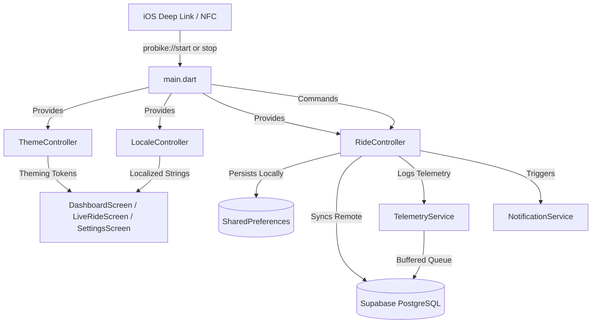
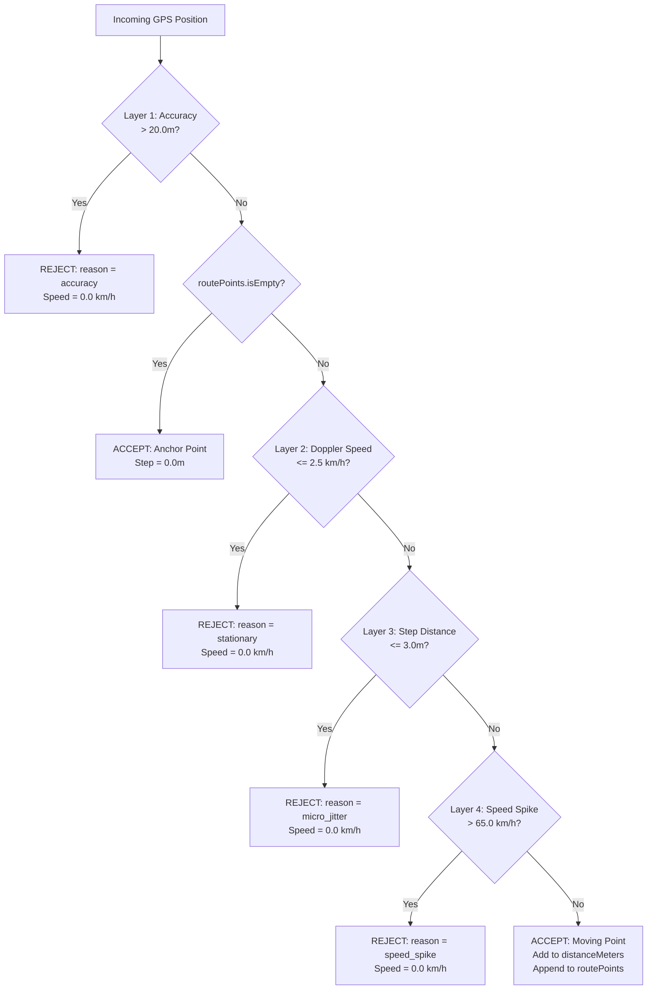
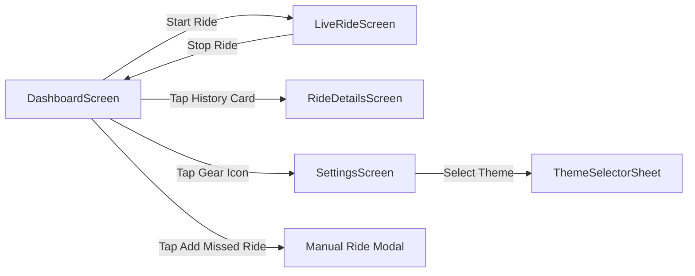

# 🚴 ProBike (`com.probike.tracker`) — AI Agent Architecture Bible
> **Target Audience:** Future AI Coding Agents & Systems Engineers.  
> **Status:** Production-Ready • 100% Passing Automated Tests (92+ Scenarios) • 0 Linter Warnings.  
> **Last Updated:** October 2026.

---

## 1. Project Identity & Hardware Context

### 1.1 App Identity
- **Product Name:** `ProBike`
- **Application Bundle ID:** `com.probike.tracker`
- **Target Platform:** iOS (iPhone 14 Pro, iOS 16+)
- **Primary Domain:** Pro Cycling Telemetry, Offline-First Route Tracking, Dynamic Cockpit & NFC Automation.

### 1.2 Target Hardware: iPhone 14 Pro
- **Screen Geometry:** 393 × 852 physical points @ 3x scale factor (1179 × 2556 px).
- **Safe Area Insets:** Dynamic Island notch at top (`59.0` pt safe area padding) and Home Indicator bar at bottom (`34.0` pt safe area padding). All modals, sheets, and telemetry cockpits are explicitly protected against clipping.
- **Display Technology:** Super Retina XDR OLED display. Themes take advantage of true black pixels (`#000000` / `#090A0F` / `#121418`) for minimum battery draw during hours of handlebar-mounted GPS navigation.
- **Background Execution:** Configured with iOS `UIBackgroundModes: location` (`AppleSettings.allowBackgroundLocationUpdates: true`, `pauseLocationUpdatesAutomatically: false`, `showBackgroundLocationIndicator: true`).
- **Screen Wakelock:** Uses `wakelock_plus` to keep the handlebar cockpit illuminated during rides and releases it immediately upon stopping.

### 1.3 Target Bike: Galaxy RL600H Hybrid
- **Frame:** Alloy Titanium / Gunmetal Matte Finish.
- **Drivetrain:** Shimano Tourney 3×7 Speed Groupset.
- **Front Fork:** Suspension with Lockout Knob (finished in an iconic electric cobalt blue accent `#0EA5E9`).
- **NFC Tag Placement:** An NTAG213 / NTAG215 waterproof NFC sticker is affixed to the handlebar stem. Tapping the top-rear of the iPhone 14 Pro onto this tag automatically triggers ride start/stop workflows via Apple Shortcuts deep links.

---

## 2. Complete Directory & File Map

```
lib/
├── config.dart                      # Supabase URL & public anon JWT constants
├── main.dart                        # App entry point, MultiProvider wiring, deep-link stream
├── l10n/
│   ├── app_strings.dart             # Bilingual localization dictionary (Egyptian Slang & Modern English)
│   └── locale_controller.dart       # Locale state management & SharedPreferences persistence
├── models/
│   └── ride_model.dart              # Core Ride entity, LatLng serialization, SyncStatus
├── screens/
│   ├── dashboard_screen.dart        # Main hub: Hero stats, weekly chart, history, manual ride modal, swipe-to-delete
│   ├── live_ride_screen.dart        # Fullscreen map, glowing polyline, navigation puck, glassmorphic telemetry
│   ├── ride_details_screen.dart     # Post-ride summary, camera-fitted route map, manual ride fallback
│   └── settings_screen.dart         # Theme picker, language toggle, hydration stepper, NFC wizard, cache diagnostics
├── services/
│   ├── notification_service.dart    # flutter_local_notifications wrapper (periodic reminders & alerts)
│   ├── ride_controller.dart         # Core brain: GPS 4-layer filter, wall-clock reconciliation, crash recovery
│   ├── shortcuts_service.dart       # NFC & Apple Shortcuts integration (clipboard deep link flow)
│   ├── supabase_service.dart        # PostgreSQL data access layer (upsert on client_id, fetch, delete)
│   └── telemetry_service.dart       # Telemetry logging pipeline, buffered queue (500 events), 14-day auto-purge
└── theme/
    ├── app_theme.dart               # Theme tokens, ColorFilter matrix for OSM, 3 complete palettes
    ├── theme_controller.dart        # Theme mode switcher & SharedPreferences persistence
    └── theme_selector_sheet.dart    # Interactive bottom sheet with live color previews

test/
├── ios_config_audit_test.dart       # Audits Info.plist (background modes, permission strings, URL schemes)
├── iphone14_pro_ui_test.dart        # Renders all screens in 393x852 viewport with Dynamic Island safe area padding
├── map_and_deeplink_test.dart       # Tests keyless OSM tile rendering, ColorFiltered matrices, deep link parsing
├── ride_details_and_delete_test.dart# Verifies route fitting, manual ride badges, and bidirectional swipe-to-delete
├── ride_logic_test.dart             # Unit tests for RideController filters, metrics, zeroing, and timing
├── settings_and_localization_test.dart# Tests settings controls, clipboard copying, language toggle, and hydration
├── stress_and_edge_cases_test.dart  # 30 Chaos & Stress scenarios across 7 failure groups (Groups A to G)
├── supabase_live_test.dart          # Live integration test against Supabase (gated by RUN_SUPABASE_LIVE_TEST=true)
├── theme_customization_test.dart    # Verifies theme token application, color matrices, and persistence
└── widget_test.dart                 # Application bootstrap smoke test
```

### Architectural State Flow


---

## 3. Strict Architectural Invariants (DO NOT BREAK)

Any future agent or contributor modifying this codebase **MUST** uphold these 4 non-negotiable architectural invariants:

### Invariant 1: Keyless, 100% Free OpenStreetMap Server Only
- ❌ **NEVER** introduce Mapbox, Google Maps SDK, or CartoDB (`cartocdn.com`). CartoDB requires API authorization / tokens and breaks with `401 Unauthorized` or `403 Forbidden`. Mapbox and Google require billable developer accounts and SDK keys.
- ✅ **ALWAYS** use the official keyless OpenStreetMap tile server:
  ```dart
  urlTemplate: 'https://tile.openstreetmap.org/{z}/{x}/{y}.png?v=probike2',
  userAgentPackageName: 'com.probike.tracker',
  ```
- To render dark and styled maps, wrap the map tiles in Flutter's `ColorFiltered` widget using `AppTheme.darkOledMapFilter` or `AppTheme.warmIvoryMapFilter`. This produces stunning dark and luxury themes without depending on any external tile styling server.

### Invariant 2: Local Persistence BEFORE Any Remote Network Calls
- ❌ **NEVER** await a Supabase network call before saving or deleting a ride locally. Cyclists travel through dead zones, tunnels, bridges, and poor signal areas.
- ✅ **ALWAYS** write updates immediately to `SharedPreferences` first:
  1. Write to `cached_rides_history`.
  2. For new rides: append to `pending_sync_rides`.
  3. For deletions: remove from `cached_rides_history` and append `clientId` to `pending_delete_rides`.
  4. Only *after* local storage is safe, trigger non-blocking remote synchronization (`unawaited(syncPendingRides())` or `deleteRide()`).

### Invariant 3: Wall-Clock Duration Reconciliation
- ❌ **NEVER** calculate `durationSeconds` solely by incrementing a variable in `Timer.periodic`.
- **Reason:** iOS aggressively throttles or suspends background timers during phone calls, low-power mode, or heavy memory pressure. If a user rides for 45 minutes but iOS paused the timer for 30 minutes, an un-reconciled timer will report 15 minutes, completely ruining average speed and stats.
- ✅ **ALWAYS** reconcile against wall-clock time on stop:
  ```dart
  if (startTime != null) {
    final elapsedWallClock = DateTime.now().difference(startTime!).inSeconds;
    if (elapsedWallClock > durationSeconds) {
      durationSeconds = elapsedWallClock;
    }
  }
  if (durationSeconds < 0) durationSeconds = 0;
  ```

### Invariant 4: Zero NaN & Infinity Defense in All Speed Calculations
- ❌ **NEVER** divide by duration or distance without validating against zero and checking for `isNaN` or `isInfinite`.
- ✅ **ALWAYS** apply the speed defense formula:
  ```dart
  final double avgSpeedKmh;
  if (durationSeconds > 0 && distanceMeters > 0) {
    final calc = (distanceMeters / 1000.0) / (durationSeconds / 3600.0);
    avgSpeedKmh = (calc.isNaN || calc.isInfinite) ? 0.0 : calc;
  } else {
    avgSpeedKmh = 0.0;
  }
  ```

---

## 4. 4-Layer GPS Anti-Drift & Physics Pipeline

In cycling apps, raw GPS data is notoriously noisy, especially when waiting at traffic signals, cycling under elevated bridges, or emerging from tunnels. `RideController` implements a deterministic 4-layer physics filter on every incoming `Position`:



### Detailed Filter Specifications
1. **Layer 1: Horizontal Accuracy Filter (`pos.accuracy > 20.0m`)**
   - Rejects coarse cell-tower triangulation or multipath reflection signals.
   - Logs `GPS_REJECTED` event with `reason: 'accuracy'`.
   - Forces `currentSpeedKmh = 0.0` so the rider sees a clean stop rather than erratic jumping.
2. **Anchor Point (First Accepted Point)**
   - When `routePoints` is empty and an accurate point arrives, it is established as the starting anchor.
   - `stepMeters` is recorded as `0.0`.
   - If `rawSpeedKmh > 2.5` and `<= 65.0`, `currentSpeedKmh`, `maxSpeedKmh`, and `minSpeedKmh` are initialized to this speed.
3. **Layer 2: Stationary Doppler Speed Filter (`rawSpeedKmh <= 2.5 km/h`)**
   - Eliminates walking, bike-fiddling, or standing still at traffic lights.
   - Rejects point with `reason: 'stationary'`.
   - **Silence Watchdog:** A 1-second periodic timer verifies `_lastPositionTime`. If no new GPS coordinate arrives for $\ge 3$ seconds, `currentSpeedKmh` is automatically clamped to `0.0 km/h`.
   - **`minSpeedKmh` Logic:** Ignores stationary `0.0` periods to accurately capture the slowest *moving* speed of the ride.
4. **Layer 3: Micro-Jitter Distance Filter (`stepMeters <= 3.0m`)**
   - Computes geodesic distance (`Geolocator.distanceBetween`) from the previous accepted point.
   - If the bike has not traveled more than 3.0 meters, the point is rejected with `reason: 'micro_jitter'`.
   - Prevents odometer inflation while the bicycle is resting on its kickstand.
5. **Layer 4: Teleportation / Tunnel Spike Filter (`rawSpeedKmh > 65.0 km/h` / `18.05 m/s`)**
   - The Galaxy RL600H is a hybrid bicycle; human sprinting rarely exceeds 55-60 km/h. Any speed reading over 65.0 km/h is a GPS satellite lock rebound (e.g., emerging from an underground pass).
   - Rejects coordinate with `reason: 'speed_spike'`.

---

## 5. Offline-First Engine, Crash Recovery & Supabase Schema

### 5.1 SharedPreferences Storage Keys
| Key Name | Type | Purpose |
| :--- | :--- | :--- |
| `cached_rides_history` | String (JSON Array) | Cached list of `RideModel`s for instant dashboard rendering. |
| `pending_sync_rides` | String (JSON Array) | Rides saved locally while offline awaiting Supabase upload. |
| `pending_delete_rides` | List\<String\> | List of `clientId`s deleted while offline awaiting remote deletion. |
| `active_ride_snapshot` | String (JSON Object) | Real-time state saved every 10s and on accepted GPS points for crash recovery. |
| `telemetry_queue` | String (JSON Array) | Persistent buffer for up to 500 telemetry events to survive app termination. |
| `reminderMinutes` | Integer | Periodic hydration/rest interval (default: `30`, min: `5`, max: `180`). |
| `selected_theme` | String | Active theme token key (`galaxy_rl600h`, `classic_neon`, `editorial_aubergine`). |
| `selected_language` | String | Active locale identifier (`ar` or `en`). |

### 5.2 Crash Recovery Engine
- While a ride is active, `_saveActiveRideSnapshot()` executes every 10 seconds and upon every accepted GPS coordinate.
- The snapshot preserves: `client_id`, `start_time`, `duration_seconds`, `distance_meters`, `current_speed_kmh`, `max_speed_kmh`, `min_speed_kmh`, and full `route_points`.
- On cold app startup, `RideController` inspects `active_ride_snapshot`. If an uncompleted ride is detected, it restores the session so no ride data is lost if iOS terminates the app under extreme memory pressure or low battery.
- A clean `stopRide()` purges `active_ride_snapshot`.

### 5.3 PostgreSQL Schema (Supabase: `mvgmsnhqsfywvugtpdsq`)

#### Table: `public.rides`
```sql
CREATE TABLE IF NOT EXISTS public.rides (
  id bigint GENERATED BY DEFAULT AS IDENTITY PRIMARY KEY,
  client_id text NOT NULL UNIQUE,
  start_time timestamptz NOT NULL,
  duration_seconds integer NOT NULL,
  distance_meters float8 NOT NULL,
  avg_speed_kmh float8 NOT NULL,
  max_speed_kmh float8 NOT NULL,
  min_speed_kmh float8 NOT NULL,
  is_manual boolean NOT NULL DEFAULT false,
  route_points jsonb NOT NULL DEFAULT '[]'::jsonb
);
```

#### Table: `public.ride_logs`
```sql
CREATE TABLE IF NOT EXISTS public.ride_logs (
  id bigint GENERATED BY DEFAULT AS IDENTITY PRIMARY KEY,
  session_id text NOT NULL,
  event_type text NOT NULL, -- 'RIDE_START', 'GPS_ACCEPTED', 'GPS_REJECTED', 'RIDE_STOP', 'ERROR'
  timestamp timestamptz NOT NULL DEFAULT now(),
  latitude float8,
  longitude float8,
  speed_mps float8,
  accuracy float8,
  reason text,              -- 'accuracy', 'stationary', 'micro_jitter', 'speed_spike'
  metadata jsonb DEFAULT '{}'::jsonb
);
```
- **Telemetry Retention:** `cleanOldLogs(14)` triggers automatically at the start of each ride session, purging records older than 14 days to preserve database quota.

---

## 6. Multi-Theme System (`lib/theme/`)

The application features three handcrafted, contrast-tailored themes controlled via `ThemeController` (`selected_theme` key):

| Theme Name | Token Mode | Background | Surface | Accent / Primary | Polyline Core & Glow | Map Filter Matrix |
| :--- | :--- | :--- | :--- | :--- | :--- | :--- |
| **Galaxy RL600H** *(Default)* | `galaxyRl600h` | `#121418` (Dark Gunmetal) | `#1A1E24` | `#0EA5E9` (Electric Cobalt Blue) | `#0EA5E9` core + `0x660EA5E9` glow | `AppTheme.darkOledMapFilter` |
| **ProBike Classic** | `classicNeon` | `#090A0F` (OLED Pure Black) | `#14161F` | `#CCFF00` (Neon Lime Cyber) | `#CCFF00` core + `0x66CCFF00` glow | `AppTheme.darkOledMapFilter` |
| **Editorial Aubergine** | `editorialAubergine` | `#F6F1E9` (Warm Ivory) | `#FFFFFF` | `#51283F` (Deep Aubergine / Plum) | `#51283F` core + `0x4451283F` glow | `AppTheme.warmIvoryMapFilter` |

### Custom ColorFilter Matrices
```dart
// Dark OLED Matrix: Inverts brightness and shifts tones toward sleek dark titanium
static const ColorFilter darkOledMapFilter = ColorFilter.matrix(<double>[
  -0.85,  0.0,   0.0,   0.0, 215.0,
   0.0,  -0.85,  0.0,   0.0, 220.0,
   0.0,   0.0,  -0.80,  0.0, 235.0,
   0.0,   0.0,   0.0,   1.0,   0.0,
]);

// Warm Ivory Matrix: Subtle warm paper-like tint for editorial daylight riding
static const ColorFilter warmIvoryMapFilter = ColorFilter.matrix(<double>[
  0.95,  0.0,   0.0,   0.0, 10.0,
  0.0,   0.92,  0.0,   0.0,  8.0,
  0.0,   0.0,   0.85,  0.0,  5.0,
  0.0,   0.0,   0.0,   1.0,  0.0,
]);
```

---

## 7. Bilingual Localization Engine (`lib/l10n/`)

Controlled by `LocaleController` (`selected_language` key: `'ar'` or `'en'`). `AppStrings` provides zero-overhead, type-safe getters for the entire UI:

### 7.1 Egyptian Cycling Slang (`ar` — Default)
- Incorporates natural, energetic Cairo street-cycling vocabulary:
  - Header greeting: *"يا هلا يا كابتن! 🚴‍♂️"*
  - Subtitle: *"جاهز لطلعة جديدة النهاردة؟"*
  - Active button: *"🚴 ابدأ رايد دلوقتي (Start)"*
  - Moving time: *"وقت البدال"*
  - Map recenter: *"سنترني ع الخريطة"*
  - Hydration card: *"منبه شرب المية والراحة 💧"*
  - Bike rig specs: *"شاسيه ألومنيوم تيتانيوم • سرعات Shimano Tourney 3x7 • قفل مساعدين"*
  - Stop shortcut: *"فرمل ووقّف الرايد"*

### 7.2 Modern Cycling English (`en`)
- Crisp, professional international cycling vernacular:
  - Header: *"Welcome back, Rider! 🚴‍♂️"*
  - Subtitle: *"Ready to crush a new ride today?"*
  - Active button: *"🚴 Let's Roll (Start Ride)"*
  - Moving time: *"Moving Time"*
  - Map recenter: *"Recenter Map"*
  - Hydration card: *"Hydration & Rest Reminder 💧"*
  - Bike rig specs: *"Alloy Titanium Frame • Shimano Tourney 3x7 • Suspension Lockout"*
  - Stop shortcut: *"Shortcut: Stop & Finish Ride"*

---

## 8. Screens & User Flows



### 8.1 `DashboardScreen`
- **Hero Stats:** Real-time summary of today's total distance, moving time, and average speed.
- **Weekly Rolling Chart:** Visual overview of rides taken across the last 7 days.
- **Active Ride Banner:** Glowing indicator shown if a ride is in progress; tapping returns directly to the live cockpit.
- **Manual Ride Entry:** Modal sheet to log missed rides (date, start time, duration in hours/minutes, distance in km). Saves with `is_manual: true`.
- **Swipe-to-Delete:** Uses Flutter `Dismissible` with red background and trash icon. Triggers a bilingual confirmation dialog. Deleting updates local cache, removes from Supabase (or queues in `pending_delete_rides` if offline), and displays a responsive SnackBar.

### 8.2 `LiveRideScreen`
- **OLED Interactive Map:** Centered on current position with keyless OSM tiles and active theme filter.
- **Dual-Layer Glowing Polyline:** Thick outer glowing line (`polylineGlow`) under thin sharp core line (`polylineCore`).
- **42×42 Navigation Puck:** Custom animated circular marker reflecting position and lock status.
- **Glassmorphic Telemetry Cockpit:** Giant digital speed readout (`km/h`), moving time (`HH:MM:SS`), distance (`km`), and top speed (`km/h`).
- **Stop Ride Action:** High-contrast emergency stop button with double haptic pulse (`heavyImpact` + `vibrate`).

### 8.3 `RideDetailsScreen`
- **Dynamic Camera Fit:** Uses `CameraFit.bounds(bounds: LatLngBounds.fromPoints(routePoints), padding: ...)` to automatically fit the entire route within the viewport.
- **Route Pins:** Green circle marker at ride start, red finish pin at final position.
- **Manual Ride Fallback:** If `is_manual == true` or `routePoints.isEmpty`, renders a clean fallback card (`AppStrings.manualRideNoMap`) with full stat breakdown.

### 8.4 `SettingsScreen`
- **Appearance:** Theme preview chip that launches `ThemeSelectorSheet`.
- **Language Toggle:** Instant switch between Egyptian Arabic and Modern English.
- **Hydration Stepper:** Adjusts periodic alert intervals between 5 and 180 minutes in 5-minute increments.
- **NFC & Apple Shortcuts Wizard:** One-tap clipboard copy of `probike://start` and `probike://stop`, deep-link tester, and 10-second guide modal.
- **Cloud & Diagnostics:** Shows connection status, pending offline rides counter, "Sync With Cloud Now" trigger, and "Clear Cached History" button.
- **Registered Bike Rig Card:** Highlighting Galaxy RL600H Hybrid specifications.

---

## 9. NFC & Deep Link Automation Architecture

### 9.1 Supported URL Schemes
Both schemes are registered in `ios/Runner/Info.plist` and parsed in `lib/main.dart`:
- `probike://start` & `probike://stop` (Primary)
- `cycletrack://start` & `cycletrack://stop` (Legacy alias for existing programmed tags)

### 9.2 Execution Lifecycle & 20x NFC Spam Protection
```dart
// Rapid-fire NFC tap debounce protection in RideController:
bool _isStarting = false;

Future<bool> startRide() async {
  if (isRiding || _isStarting) return false;
  _isStarting = true;
  try {
    // ... initialize session & GPS stream
  } finally {
    _isStarting = false;
  }
}
```
If an iPhone stays in contact with an NFC sticker and fires the deep link 20 times in rapid succession, `RideController` rejects duplicate executions cleanly without restarting the ride or losing distance.

### 9.3 iOS Shortcuts & Unsigned `.shortcut` Elimination
- **The Problem:** Direct `.shortcut` binary files cannot be imported into iOS without Apple developer team signatures or iCloud sharing links. Attempting to download `.shortcut` files from Supabase storage yields `404` or iOS security rejections.
- **The Architecture Solution (`ShortcutsService`):**
  1. The user taps **"Setup Shortcut 📲"** in Settings.
  2. `ShortcutsService` copies `probike://start` (or `probike://stop`) directly to the iOS clipboard with `Clipboard.setData`.
  3. A 2-step instructional bottom sheet explains:
     - Step 1: Open Apple Shortcuts -> Create Personal Automation -> When "NFC" is tapped.
     - Step 2: Add "Open URLs" action -> Paste copied link -> Set "Run Immediately" (no prompt).

---

## 10. The 92+ Automated Test Suite & CI/CD

### 10.1 Test Suite Breakdown
| Test File | Test Count | Responsibility |
| :--- | :--- | :--- |
| `stress_and_edge_cases_test.dart` | **30 Scenarios** | 7 Chaos Groups: GPS tunnels, blackout, low battery, iOS suspension, backend failure, rapid NFC taps. |
| `ride_logic_test.dart` | **25 Tests** | Unit tests for 4-layer GPS filter, speed calculations, NaN protections, wall-clock duration sync. |
| `map_and_deeplink_test.dart` | **10 Tests** | OSM keyless URLs, ColorFilter matrix verification, deep link parsing (`probike://` & `cycletrack://`). |
| `ride_details_and_delete_test.dart` | **9 Tests** | Route bounds calculation, manual ride fallback, bidirectional swipe-to-delete (cancel & confirm). |
| `settings_and_localization_test.dart` | **7 Tests** | Theme switching, Egyptian/English strings, hydration stepper bounds, clipboard deep-link copy. |
| `iphone14_pro_ui_test.dart` | **4 Tests** | iPhone 14 Pro screen resolution (393x852) & Dynamic Island safe area padding verification. |
| `theme_customization_test.dart` | **4 Tests** | AppThemeTokens palette integrity, SharedPreferences persistence, selector sheet interaction. |
| `ios_config_audit_test.dart` | **2 Tests** | Validates Info.plist (background modes, permission strings, URL schemes). |
| `widget_test.dart` | **1 Test** | Application bootstrap smoke test. |
| `supabase_live_test.dart` | **Live Roundtrip** | Live integration against Supabase project `mvgmsnhqsfywvugtpdsq` (gated by env var). |

### 10.2 The 30 Chaos & Stress Scenarios (`stress_and_edge_cases_test.dart`)
- **GROUP A (Scenarios 1-4): Everyday Scenarios** — Standard 3-min ride, instantaneous start/stop, zero-distance rides, 2-hour steady-pace endurance.
- **GROUP B (Scenarios 5-8): Street & Glitch Scenarios** — Long red light (speed zeroing), GPS accuracy jumps (>20m), 3m micro-jitter filter, tunnel exit speed spike (>65 km/h).
- **GROUP C (Scenarios 9-14): Catastrophic Failures** — 20x rapid NFC spam, offline start & stop with queueing, app crash & snapshot recovery, NaN/Infinity clock skew, corrupt JSON recovery.
- **GROUP D (Scenarios 15-19): iOS Lifecycle & Power** — Phone call interruption, background timer throttling (wall-clock sync), low battery mode, notification flood, wake lock toggle.
- **GROUP E (Scenarios 20-24): Street Terrain & Physics** — Cobblestone vibrations, U-turns, highway overpass elevation shifts, start/stop in same GPS cell, extreme top speed vs moving min speed.
- **GROUP F (Scenarios 25-28): Storage Resilience & Concurrency** — 50 offline rides sync, manual ride entry overlap, offline deletion queueing, local cache clearing without affecting pending queue.
- **GROUP G (Scenarios 29-30): Network & Backend Chaos** — Supabase 500 error / offline retry loop, telemetry buffer cap at 500 items.

### 10.3 Execution Commands

#### Static Analysis (Must Report 0 Issues)
```bash
flutter analyze
```

#### Run Full Automated Test Suite (All 92 Tests)
```bash
flutter test
```

#### Run Specific Test File
```bash
flutter test test/stress_and_edge_cases_test.dart
flutter test test/ride_details_and_delete_test.dart
```

#### Run Live Supabase Integration Test
```powershell
# Windows PowerShell
$env:RUN_SUPABASE_LIVE_TEST="true"; flutter test test/supabase_live_test.dart
```
```bash
# macOS / Linux Bash
RUN_SUPABASE_LIVE_TEST=true flutter test test/supabase_live_test.dart
```

### 10.4 CI/CD Pipeline (`codemagic.yaml`)
- **Machine Type:** `mac_mini_m2` (Xcode Latest, Flutter Stable)
- **Workflow:** `ios-unsigned-ipa`
- **Pipeline Steps:**
  1. `flutter config --enable-swift-package-manager`
  2. `flutter pub get`
  3. `flutter analyze`
  4. `flutter test`
  5. `flutter build ios --release --no-codesign`
  6. Package unsigned IPA: `cp -r build/ios/iphoneos/Runner.app Payload/ && zip -r -y ProBike_iOS.ipa Payload`
- **Output Artifact:** `ProBike_iOS.ipa` ready for sideloading via AltStore, Sideloadly, or TrollStore.
