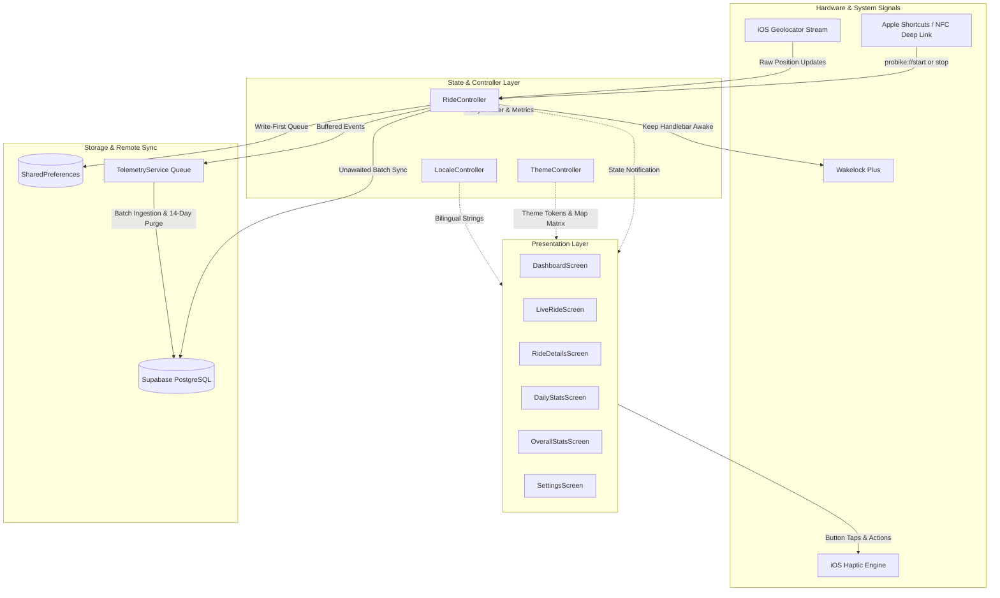

# 🚴 ProBike Documentation Hub

> **Application Identifier:** `com.probike.tracker`  
> **Status:** Production-Ready • 156 Automated Tests Passing (100%) • 0 Linter Issues  
> **Target Platform:** iOS (iPhone 14 Pro, iOS 16+)  
> **Companion Bike:** Galaxy RL600H Hybrid (Alloy Titanium)

Welcome to the central technical documentation repository for **ProBike**. This documentation suite details the engineering architecture, physics pipelines, offline synchronization engine, hardware integrations, cartography styling, bilingual design system, and automated testing infrastructure.

---

## 📚 Documentation Directory

### 🚴 1. Cycling Module Documentation (Core ProBike)

| Document | Topic & Focus Area | Key Architectural Components |
| :--- | :--- | :--- |
| **[`architecture.md`](./architecture.md)** | **System Architecture & Navigation** | App lifecycle, `ChangeNotifier` state trees, 6 core screens, navigation flows, and UI hierarchy. |
| **[`gps-telemetry-physics.md`](./gps-telemetry-physics.md)** | **4-Layer GPS Filter & Physics** | Horizontal accuracy rejection, Doppler stationary watchdog, micro-jitter filter, speed spike defense, and wall-clock duration sync. |
| **[`offline-sync-database.md`](./offline-sync-database.md)** | **Offline-First & Supabase Sync** | `SharedPreferences` persistence, crash recovery snapshotting, PostgreSQL schema (`rides`, `ride_logs`), idempotent `clientId` upserts, and midnight attribution. |
| **[`maps-and-routing.md`](./maps-and-routing.md)** | **Cartography & Route Rendering** | Stadia Maps Alidade Smooth Dark raster tiles, safe compile-time key injection (`--dart-define`), fallback tile provider, glowing dual polylines, and camera bounds fitting. |
| **[`hardware-nfc-shortcuts.md`](./hardware-nfc-shortcuts.md)** | **Hardware & NFC Automation** | iPhone 14 Pro display geometry, Dynamic Island & Home Indicator safe insets, Galaxy RL600H specs, deep links (`probike://`), Apple Shortcuts, and rapid-tap debounce. |
| **[`design-system-localization.md`](./design-system-localization.md)** | **Theming, UI & Bilingual Engine** | 3 tailored themes (`Galaxy RL600H`, `ProBike Classic`, `Editorial Aubergine`), vector canvas share card (`DailyShareCard`), Egyptian Cycling Slang vs Modern English, and RTL layout. |
| **[`testing-ci-cd.md`](./testing-ci-cd.md)** | **Automated Testing & CI/CD** | 156-test catalog across 16 test files, 30 Chaos & Stress scenarios (Groups A–G), Codemagic unsigned IPA pipeline, and GitHub Actions. |

---

### 🏋️ 2. Gym Module & AI Agent Governance Hub (`docs/gym/`)

| Document | Purpose & Working Role | Key Content & Rules |
| :--- | :--- | :--- |
| **[`gym/STATUS.md`](./gym/STATUS.md)** | **Live Agent Dashboard** | Current active phase, in-progress task, next task, active git branch, and blockers. **(Read on every agent session)** |
| **[`gym/TASKS.md`](./gym/TASKS.md)** | **Master Task Registry** | Granular breakdown of all Gym tasks (`GYM-P0-001` to `GYM-P4-005`), acceptance criteria, and states (`TODO` -> `DONE`). |
| **[`gym/CODEMAP.md`](./gym/CODEMAP.md)** | **File Map & Isolation Invariants** | Directory responsibilities for `lib/features/gym/`, SQLite WAL setup, and isolation rules protecting cycling telemetry. |
| **[`gym/TEST_PLAN.md`](./gym/TEST_PLAN.md)** | **Test Matrix & Scenarios** | Test scenarios across 4 levels (Unit, Widget, Integration, iPhone Manual). Tasks cannot be marked `DONE` without verification. |
| **[`gym/CHANGELOG.md`](./gym/CHANGELOG.md)** | **Completed Changes Log** | Chronological record of completed and verified features. |
| **[`gym/AGENT_LOG.md`](./gym/AGENT_LOG.md)** | **Architectural Decision Records** | Log of technical choices, trade-offs, and decisions made across agent turns. |
| **[`../new-plan.md`](../new-plan.md)** | **Master Engineering Blueprint** | Comprehensive reference specification for the Gym personal edition. |

---

## 🏛️ High-Level System Architecture

---

## ⚡ Core Invariants (Non-Negotiable)

1. **Stadia Maps Alidade Smooth Dark:**
   - Tile URL: `https://tiles.stadiamaps.com/tiles/alidade_smooth_dark/{z}/{x}/{y}.png?api_key=<key>`
   - Key passed strictly at compile time: `--dart-define=STADIA_MAPS_API_KEY=<key>`.
   - Never dispatch unauthenticated network calls; `SafeEmptyTileProvider` activates when the key is omitted.
2. **Local Persistence BEFORE Remote Network:**
   - Every ride save, snapshot update, or deletion must complete in `SharedPreferences` before dispatching Supabase calls.
3. **Wall-Clock Duration Reconciliation:**
   - Never rely on raw `Timer.periodic` increments due to background iOS suspension; always reconcile against `DateTime.now().difference(startTime)`.
4. **Zero NaN & Zero Infinity Defense:**
   - All distance-over-time divisions validate `durationSeconds > 0 && distanceMeters > 0` and filter `calc.isNaN || calc.isInfinite`.
5. **Gym Module Architectural Isolation:**
   - The Gym Module resides exclusively in `lib/features/gym/`.
   - Never mutate Bike Tracking state, database records, or GPS telemetry pipelines from Gym features.
   - Integration is strictly read-only via `lib/integration/activity_bridge/gym_bike_bridge.dart` to calculate the 3D Muscle Load Heatmap.
6. **SQLite WAL Mode & Audio Session Harmony:**
   - Enforce `PRAGMA journal_mode=WAL;` and a single serialized write queue for local gym sets to avoid write locks with background GPS.
   - All audio/video playback must use `AppAudioSessionCoordinator` with `mixWithOthers: true` (never interrupt background Spotify playback).
