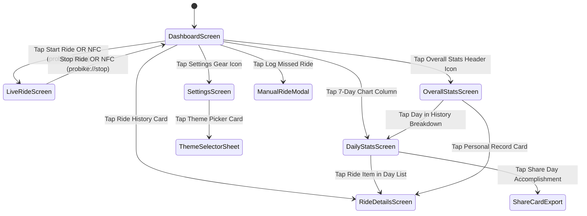

# 🏛️ System Architecture & Navigation

> **Context:** Comprehensive application layer architecture, state management patterns, and screen lifecycle.  
> **Source Directory:** [`lib/`](file:///f:/dev/bike-track/lib)

---

## 1. Architectural Overview

ProBike follows a decoupled, **Controller-Service-View** architectural pattern with reactive state binding powered by `Provider` and `ChangeNotifier`. The system isolates platform telemetry and GPS acquisition from UI rendering, enforcing unidirectional data flow:

```mermaid
flowchart TD
    subgraph Core [Entry Point: lib/main.dart]
        MAIN[main()] --> PROV[MultiProvider Setup]
        PROV --> APP[ProBikeApp]
    end

    subgraph Controllers [State Layer: ChangeNotifier]
        RC[RideController]
        TC[ThemeController]
        LC[LocaleController]
    end

    subgraph Services [Service Layer]
        SBS[SupabaseService]
        NOTIF[NotificationService]
        TEL[TelemetryService]
        SHORT[ShortcutsService]
        SHR[ShareService]
    end

    subgraph Views [Presentation Layer]
        DASH[DashboardScreen]
        LIVE[LiveRideScreen]
        DET[RideDetailsScreen]
        DAILY[DailyStatsScreen]
        OVR[OverallStatsScreen]
        SETT[SettingsScreen]
    end

    PROV --> RC
    PROV --> TC
    PROV --> LC

    RC --> SBS
    RC --> NOTIF
    RC --> TEL
    RC --> SHR

    RC -.-> DASH
    RC -.-> LIVE
    RC -.-> DET
    RC -.-> DAILY
    RC -.-> OVR
    RC -.-> SETT
```

---

## 2. Presentation Layer: The 6 Core Screens

```
lib/screens/
├── dashboard_screen.dart        # Primary landing hub: today's summary, rolling 7-day chart, recent rides
├── live_ride_screen.dart        # Fullscreen handlebar telemetry cockpit, active GPS map, stop controls
├── ride_details_screen.dart     # Post-ride deep dive: camera-fitted map, speed metrics, route pins
├── daily_stats_screen.dart      # Day Analytics: chronological list, multi-route dark map, filter chips, share card
├── overall_stats_screen.dart    # Personal records, period segmentation (week/month/year/all), dynamic bar chart
└── settings_screen.dart         # Theme switcher, language toggle, hydration stepper, NFC automation wizard
```

### 2.1 `DashboardScreen` ([`dashboard_screen.dart`](file:///f:/dev/bike-track/lib/screens/dashboard_screen.dart))
- **Hero Stats:** Real-time metrics for today's aggregate cycling distance (`km`), moving pedal time, and average speed.
- **7-Day Interactive Rolling Chart:** Visual bar chart of the past 7 days. Tapping any bar column navigates directly to `DailyStatsScreen` for that specific date.
- **Active Ride Banner:** If an active ride session is running or restored after crash recovery, an ambient glowing banner is displayed; tapping returns the cyclist directly to `LiveRideScreen`.
- **Manual Ride Modal:** Provides entry for offline indoor trainer rides or missed sessions (date, start time, duration in minutes/hours, distance). Sets `is_manual: true`.
- **Bidirectional Swipe-to-Delete:** Uses Flutter `Dismissible` with haptic feedback, confirmation modal, and SnackBar rollback protection.

### 2.2 `LiveRideScreen` ([`live_ride_screen.dart`](file:///f:/dev/bike-track/lib/screens/live_ride_screen.dart))
- **Active Handlebar Cockpit:** Screen wakelock (`WakelockPlus.enable()`) prevents display sleep.
- **Edge-to-Edge Cartography:** Stadia Maps Alidade Smooth Dark raster tiles bleed behind the status bar and Dynamic Island cutout.
- **Telemetry Readout:** High-contrast digital telemetry cards rendering current speed (`km/h`), elapsed pedal time, total distance, and top speed with `FontFeature.tabularFigures()`.
- **Stop Ride Safety:** High-contrast crimson stop button with double haptic feedback (`heavyImpact` + `vibrate`) to eliminate accidental stops while wearing cycling gloves.

### 2.3 `RideDetailsScreen` ([`ride_details_screen.dart`](file:///f:/dev/bike-track/lib/screens/ride_details_screen.dart))
- **Dynamic Camera Bounds Fitting:** Computes `LatLngBounds.fromPoints(routePoints)` and auto-fits the camera viewport using `CameraFit.bounds` with defensive padding (`EdgeInsets.all(32)`).
- **Route Pins:** Green circular pin marks ride start; red finish checkered marker identifies final coordinate.
- **Manual Ride Fallback:** Renders a clean stat breakdown card when `is_manual: true` or GPS route coordinates are empty.

### 2.4 `DailyStatsScreen` ([`daily_stats_screen.dart`](file:///f:/dev/bike-track/lib/screens/daily_stats_screen.dart))
- **Multi-Ride Day Cartography:** Unifies multiple rides taken on the same calendar day into a single interactive dark map.
- **Route Filter Chips:** Allows isolating individual rides or viewing all daily routes simultaneously. Non-selected routes are dimmed.
- **Chronological Breakdown:** Displays individual ride cards with start times, durations, distances, and average speeds.
- **Vector Share Card Generator:** Renders an offscreen `DailyShareCard` canvas and exports high-res PNGs for social sharing.

### 2.5 `OverallStatsScreen` ([`overall_stats_screen.dart`](file:///f:/dev/bike-track/lib/screens/overall_stats_screen.dart))
- **Period Segmentation:** Switches analysis periods dynamically: `Day`, `Week`, `Month`, `Year`, and `All Time`.
- **Metric Breakdown Switcher:** Dynamically re-keys charts and breakdowns across `Distance`, `Duration`, `Average Speed`, and `Ride Count`.
- **Personal Records Showcase:** Computes all-time longest ride, highest average speed, and highest single-day mileage.
- **Lifetime Odometer:** Total cumulative cycling distance rendered in retro digital odometer typography.

### 2.6 `SettingsScreen` ([`settings_screen.dart`](file:///f:/dev/bike-track/lib/screens/settings_screen.dart))
- **Theme Selection:** Launches `ThemeSelectorSheet` to switch between `Galaxy RL600H`, `ProBike Classic`, and `Editorial Aubergine`.
- **Language Switcher:** Instant toggle between authentic Egyptian Cycling Slang (`ar`) and Modern English (`en`).
- **Hydration & Rest Stepper:** Adjusts alert intervals from 5 to 180 minutes in 5-minute increments.
- **NFC & Apple Shortcuts Setup:** Copies deep links to clipboard (`probike://start`, `probike://stop`) and displays 2-step setup instructions.
- **Diagnostics & Cloud Sync:** Shows cloud connectivity status, pending sync count, manual sync trigger, and cache reset controls.

---

## 3. Navigation & Screen Flow Diagram



---

## 4. State Management Layer

The application utilizes three main `ChangeNotifier` controllers provided at the root widget tree:

### 4.1 `RideController` ([`ride_controller.dart`](file:///f:/dev/bike-track/lib/services/ride_controller.dart))
- Manages real-time GPS stream subscriptions and the 4-layer anti-drift filter.
- Tracks ride metrics: `distanceMeters`, `durationSeconds`, `currentSpeedKmh`, `maxSpeedKmh`, `minSpeedKmh`.
- Enforces wall-clock duration reconciliation against iOS background suspensions.
- Persists state to `SharedPreferences` locally before executing remote sync.
- Coordinates crash recovery snapshots every 10 seconds.
- Computes period aggregations (`DaySummary`, `PeriodSummary`, `PersonalRecords`).

### 4.2 `ThemeController` ([`theme_controller.dart`](file:///f:/dev/bike-track/lib/theme/theme_controller.dart))
- Manages the active design theme token (`galaxyRl600h`, `classicNeon`, `editorialAubergine`).
- Persists user theme choice to key `selected_theme`.
- Provides color matrices, map overlay filters, and polyline styling to the UI.

### 4.3 `LocaleController` ([`locale_controller.dart`](file:///f:/dev/bike-track/lib/l10n/locale_controller.dart))
- Manages active UI locale (`'ar'` or `'en'`).
- Persists user locale choice to key `selected_language`.
- Provides zero-overhead access to localized strings via `AppStrings.of(context)`.

---

## 5. Service Layer Dependency Injection

Services are instantiated and injected in `lib/main.dart` with clear abstractions:

| Service Interface | Production Implementation | Test Mock / Fake |
| :--- | :--- | :--- |
| `SupabaseService` | `SupabaseService` (HTTP client to Supabase REST) | `MockSlowSupabaseService`, `MockTestSupabaseService` |
| `INotificationService` | `NotificationService` (`flutter_local_notifications`) | `FakeNotificationService`, `FakeTestNotificationService` |
| `ITelemetryService` | `TelemetryService` (In-memory ring buffer + Supabase) | `FakeTelemetryService`, `FakeTestTelemetryService` |
| `IShareService` | `SharePlusService` (`share_plus` XFile exporter) | `FakeShareTestService` |
| `ShortcutsService` | `ShortcutsService` (iOS clipboard & modal helper) | Unit-tested via `MethodChannel` fakes |

