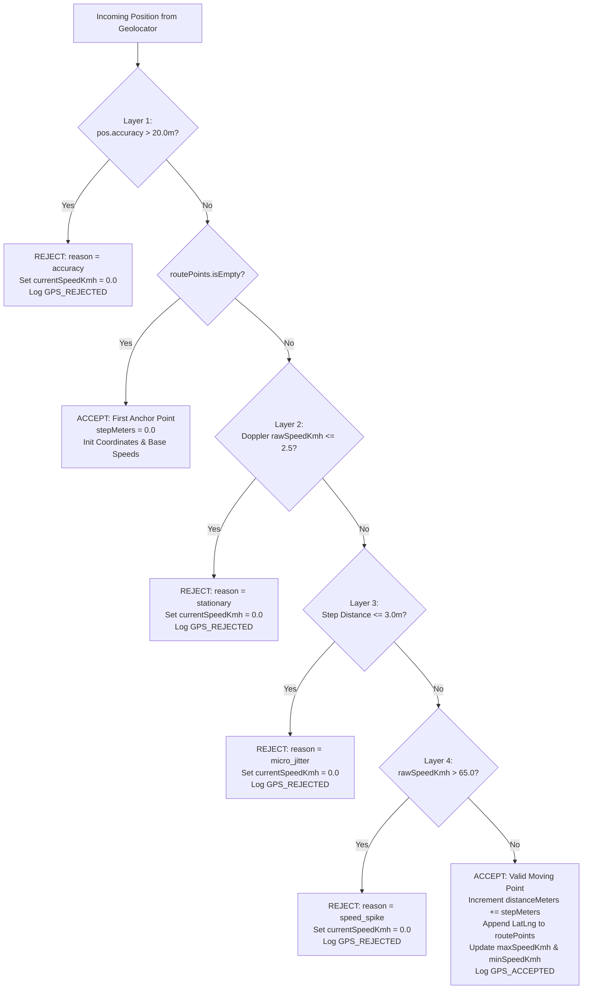

# 🛡️ 4-Layer GPS Anti-Drift Engine & Cycling Physics

> **Context:** Mathematical and physical pipeline rejecting noise, satellite reflections, tunnel spikes, and iOS background timer throttling.  
> **Source Files:** [`lib/services/ride_controller.dart`](file:///f:/dev/bike-track/lib/services/ride_controller.dart), [`lib/services/telemetry_service.dart`](file:///f:/dev/bike-track/lib/services/telemetry_service.dart)

---

## 1. The Physics Problem in Urban Cycling

Handlebar-mounted smartphones navigating urban corridors face extreme GPS noise profiles:
1. **Tall Buildings & Multipath Reflections:** Satellite signals bounce off concrete facades, reporting sudden 50–100m jumps in position while stationary at traffic lights.
2. **Stationary Micro-Jitter:** When resting on a bike kickstand or waiting at an intersection, raw GPS chips emit small micro-movements (0.5–2.5m) at low Doppler speeds, causing cumulative "phantom distance" inflation.
3. **Tunnel & Underpass Teleportation:** Signal loss in tunnels followed by satellite re-acquisition creates instantaneous coordinate displacement jumps yielding impossible speed calculations ($>100\text{ km/h}$).
4. **iOS Background Suspension:** Background timers in iOS are throttled or suspended during phone calls or low-power states, causing raw `Timer.periodic` counters to severely lag real elapsed time.

---

## 2. Deterministic 4-Layer Filtering Pipeline

Every raw `Position` event emitted by `Geolocator.getPositionStream` traverses a deterministic 4-layer validation pipeline in `RideController`:



---

## 3. Filter Layer Technical Specifications

### Layer 1: Horizontal Accuracy Threshold (`accuracy > 20.0m`)
```dart
if (position.accuracy > 20.0) {
  currentSpeedKmh = 0.0;
  _telemetryService.logEvent(
    eventType: 'GPS_REJECTED',
    latitude: position.latitude,
    longitude: position.longitude,
    accuracy: position.accuracy,
    reason: 'accuracy',
  );
  notifyListeners();
  return;
}
```
- **Rationale:** Cellular triangulation and degraded GPS fixes routinely produce accuracy circles $>30\text{m}$. Accepting coordinates during poor satellite geometry corrupts route geometry and inflates distance.
- **UX Guarantee:** Clamps `currentSpeedKmh` to `0.0` immediately so the rider sees a clean stop rather than erratic speedometer jumps.

### Layer 2: Stationary Doppler Speed Filter (`rawSpeedKmh <= 2.5 km/h`)
```dart
final rawSpeedKmh = (position.speed * 3.6).clamp(0.0, 200.0);
if (rawSpeedKmh <= 2.5) {
  currentSpeedKmh = 0.0;
  _telemetryService.logEvent(
    eventType: 'GPS_REJECTED',
    latitude: position.latitude,
    longitude: position.longitude,
    speedMps: position.speed,
    reason: 'stationary',
  );
  notifyListeners();
  return;
}
```
- **Rationale:** Walking pace or handlebar movement while stationary at traffic lights generates Doppler speeds $<2.5\text{ km/h}$. Filtering this layer preserves true moving averages.
- **Silence Watchdog:** A 1-second periodic watchdog inspects `_lastPositionTime`. If no valid GPS position arrives for $\ge 3\text{ seconds}$, `currentSpeedKmh` is clamped to `0.0 km/h`.

### Layer 3: Geodesic Micro-Jitter Filter (`stepMeters <= 3.0m`)
```dart
final lastPoint = routePoints.last;
final stepMeters = Geolocator.distanceBetween(
  lastPoint.latitude,
  lastPoint.longitude,
  position.latitude,
  position.longitude,
);

if (stepMeters <= 3.0) {
  currentSpeedKmh = 0.0;
  _telemetryService.logEvent(
    eventType: 'GPS_REJECTED',
    latitude: position.latitude,
    longitude: position.longitude,
    reason: 'micro_jitter',
    metadata: {'step_meters': stepMeters},
  );
  notifyListeners();
  return;
}
```
- **Rationale:** Prevents odometer inflation while the bicycle rests on its kickstand.

### Layer 4: Teleportation / Speed Spike Filter (`rawSpeedKmh > 65.0 km/h`)
```dart
if (rawSpeedKmh > 65.0) {
  currentSpeedKmh = 0.0;
  _telemetryService.logEvent(
    eventType: 'GPS_REJECTED',
    latitude: position.latitude,
    longitude: position.longitude,
    speedMps: position.speed,
    reason: 'speed_spike',
  );
  notifyListeners();
  return;
}
```
- **Rationale:** On a hybrid bicycle (Galaxy RL600H), sprinting speeds rarely exceed 50–55 km/h. Any reading $>65.0\text{ km/h}$ represents a satellite rebound spike (e.g., exiting an underpass).

---

## 4. Moving Minimum Speed Logic (`minSpeedKmh`)

Calculating the minimum speed of a ride cannot use naive zero comparisons, because cycling involves routine stops at traffic lights. ProBike isolates the minimum **moving** speed:
```dart
// Only track minSpeed for moving speeds (> 2.5 km/h)
if (rawSpeedKmh > 2.5) {
  if (minSpeedKmh == 0.0 || rawSpeedKmh < minSpeedKmh) {
    minSpeedKmh = rawSpeedKmh;
  }
}
```

---

## 5. Wall-Clock Duration Reconciliation

### The iOS Background Suspension Problem
When iOS locks the screen or enters Low Power Mode, `Timer.periodic` execution is throttled or completely paused. If an un-reconciled timer runs during a 60-minute ride, the app may register only 25 minutes of timer ticks, leading to grossly inflated and erroneous average speed figures ($>50\text{ km/h}$).

### Reconciliation Algorithm
On ride termination or metric calculation, `RideController` reconciles recorded duration against true wall-clock time:
```dart
if (startTime != null) {
  final elapsedWallClock = DateTime.now().difference(startTime!).inSeconds;
  if (elapsedWallClock > durationSeconds) {
    durationSeconds = elapsedWallClock;
  }
}
if (durationSeconds < 0) durationSeconds = 0;
```

---

## 6. Defensive Speed Equations (Zero NaN / Infinity)

Dividing distance by duration can cause division by zero if duration or distance is 0, producing `double.nan` or `double.infinity`. ProBike enforces a strict mathematical guard across all controllers, screens, and models:

```dart
final double avgSpeedKmh;
if (durationSeconds > 0 && distanceMeters > 0) {
  final calc = (distanceMeters / 1000.0) / (durationSeconds / 3600.0);
  avgSpeedKmh = (calc.isNaN || calc.isInfinite) ? 0.0 : calc;
} else {
  avgSpeedKmh = 0.0;
}
```

---

## 7. Telemetry Pipeline & Memory Bounds

`TelemetryService` logs physics and lifecycle events to Supabase (`public.ride_logs`):
- **Events Logged:** `RIDE_START`, `GPS_ACCEPTED`, `GPS_REJECTED`, `RIDE_PAUSE`, `RIDE_RESUME`, `RIDE_STOP`, `ERROR`.
- **In-Memory Ring Buffer:** Capped at **500 events** to prevent unbounded RAM usage during extended rides.
- **Fail-Safe Flushing:** Flush failures (e.g. offline status) suppress errors safely and preserve un-flushed items for future retry.
- **14-Day Automated Purge:** Executes `cleanOldLogs(14)` at the beginning of each session to prevent database bloat.

