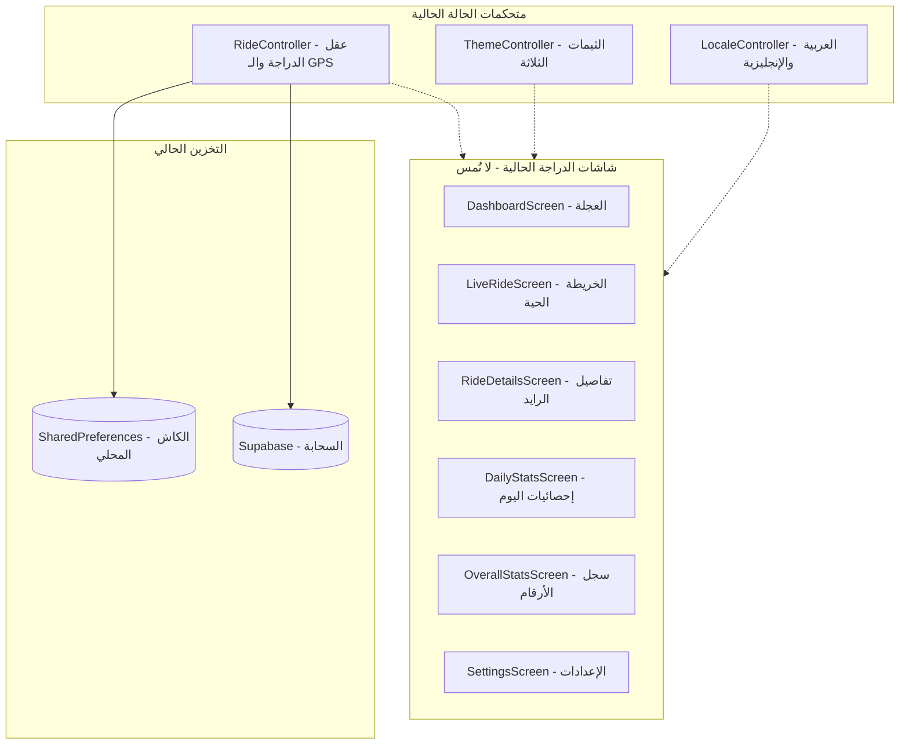
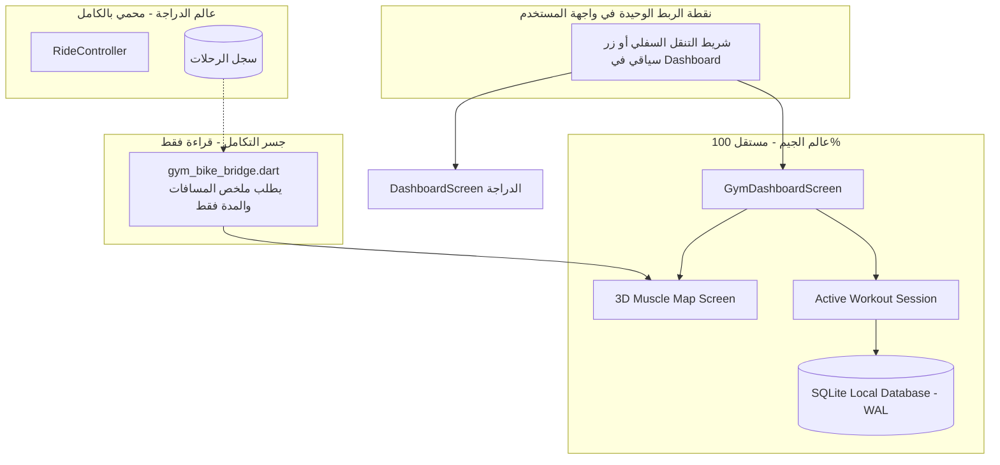

# 🏛️ ProBike — Existing Architecture Audit (`EXISTING_ARCHITECTURE.md`)

> **تاريخ التوثيق:** 11 نوفمبر 2026  
> **الغرض:** توضيح المعمارية الحالية لـ ProBike وتحديد نقطة الاتصال الوحيدة والآمنة للـ Gym Module.

---

## 1. المعمارية الحالية لـ ProBike (Cycling Telemetry)

---

## 2. معمارية الدمج النظيف للـ Gym Module

بدلاً من تشابك الكود، سيتم دمج الجيم عبر **نقطة دخول منفصلة في الواجهة** و **جسر تكاملي للقراءة فقط في البيانات**:

---

## 3. نقاط التلاقي والدمج المعتمدة (Integration Points)

1. **الواجهة (UI Navigation):**
   - إضافة خيار أو زر انتقال واضح وسلس من شاشة `DashboardScreen` أو شريط تنقل خفيف يقود المستخدم إلى `GymDashboardScreen` داخل `lib/features/gym/presentation/dashboard/`.
2. **البيانات (Data Bridge):**
   - الجيم لا يستعلم عن قاعدة بيانات الدراجة مباشرة، بل يستدعي دالة خفيفة:
     `List<CyclingDaySummary> getRecentCyclingLoad(int days)`
     والتي تُرجع فقط المسافة والمدة لتلوين عضلات الفخذ والسمانة على مجسم الـ 3D (Heatmap).
3. **الثيمات وتجربة الاستخدام:**
   - شاشات الجيم ستستخدم نفس `AppTheme` الحالية للمحافظة على الفخامة الداكنة والتجانس البصري دون كتابة ثيمات مكررة.

