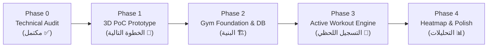

# 🚀 ProBike — Gym Module Integration Plan (`GYM_MODULE_INTEGRATION_PLAN.md`)

> **تاريخ التحديث:** 11 نوفمبر 2026  
> **حالة الخطة:** معتمدة للبدء الفوري

---

## 1. الترتيب الزمني للتنفيذ (Implementation Sequence)

---

## 2. تفاصيل الخطوات القادمة

### الخطوة 1: Phase 1 — 3D PoC (المهمة الحالية)
1. **تجهيز ملف المجسم:** الحصول على نموذج `male_fitness_anatomy.glb` وفحص أسماء الـ Meshes (مثل `chest_pec_major_L`, `chest_pec_major_R`).
2. **بناء نموذج RealityKit التجريبي:** إنشاء بروتوتايب محلي خفيف لاختبار اللمس (Tap) والمسح المستمر (Scrubbing).
3. **بناء نموذج Three.js التجريبي:** إنشاء بروتوتايب عبر `flutter_inappwebview` وسيرفر محلي.
4. **المقارنة واعتماد المحرك:** قياس الـ FPS واستهلاك الرام، وحسم القرار في وثيقة `3D_POC_REPORT.md`.

### الخطوة 2: Phase 2 — البنية الأساسية وقاعدة البيانات
1. إنشاء مجلد `lib/features/gym/` بالكامل.
2. بناء محرك التخزين المحلي `lib/features/gym/data/gym_database.dart` مع `PRAGMA journal_mode=WAL;`.
3. بذر بيانات التمارين مع الـ Assets المحلية.
4. بناء شاشة `GymDashboardScreen` وشاشة تفاصيل العضلة والتمارين.

### الخطوة 3: Phase 3 — محرك تسجيل التمرين
1. بناء شاشة `ActiveWorkoutScreen` النظيفة والسريعة.
2. تفعيل خوارزمية `Ghost Pre-fill` من آخر جلسة بضغطة زر واحدة.
3. إضافة أزرار الزيادة السريعة (+2.5, +5, +10 kg) ونوع المجموعة (`WARMUP`, `WORKING`, `DROP`).
4. تفعيل مؤقت الراحة التلقائي وربطه مع الجزيرة التفاعلية (Dynamic Island) وحماية تشغيل Spotify.

### الخطوة 4: Phase 4 — التحليلات وخريطة الإجهاد
1. ربط `gym_bike_bridge.dart` لقراءة رحلات الدراجة.
2. تلوين العضلات المجهدة (Heatmap) على المجسم ثلاثي الأبعاد.
3. إضافة ميزة تصدير الداتابيز إلى تطبيق Files للحفظ اليدوي.
4. إجراء الفحص النهائي لجميع سيناريوهات الـ Edge Cases.

