# ☁️ Offline-First Persistence, Sync Engine & Database

> **Context:** Local-first architecture, crash recovery snapshots, conflict-free deduplication, and PostgreSQL schema.  
> **Source Files:** [`lib/services/ride_controller.dart`](file:///f:/dev/bike-track/lib/services/ride_controller.dart), [`lib/services/supabase_service.dart`](file:///f:/dev/bike-track/lib/services/supabase_service.dart), [`lib/models/ride_model.dart`](file:///f:/dev/bike-track/lib/models/ride_model.dart)

---

## 1. Offline-First Core Philosophy

Cyclists frequently ride through cellular dead zones, bridges, rural paths, and underground passes. Network connectivity must **never** be on the critical path of ride lifecycle events:
- Starting a ride **must never block** on a network handshake.
- Stopping a ride **must immediately succeed locally** and display the summary screen even in airplane mode.
- Deleting a ride **must immediately update local state and UI**.

```mermaid
sequenceDiagram
    autonumber
    actor Cyclist as Cyclist / UI
    participant RC as RideController
    participant SP as SharedPreferences (Local)
    participant SB as Supabase REST API (Remote)

    Cyclist->>RC: stopRide()
    RC->>RC: Reconcile wall-clock & calculate metrics
    RC->>SP: 1. Save to cached_rides_history
    RC->>SP: 2. Append to pending_sync_rides
    RC->>SP: 3. Delete active_ride_snapshot
    RC-->>Cyclist: notifyListeners() (Instant UI Update)
    
    rect rgb(20, 30, 45)
        Note over RC,SB: Non-blocking Background Sync
        RC->>SB: 4. unawaited(syncPendingRides())
        alt Remote Success
            SB-->>RC: HTTP 200 OK
            RC->>SP: 5. Remove from pending_sync_rides
        else Remote Failure / Offline
            SB-->>RC: SocketException / 500
            RC->>RC: Keep in pending_sync_rides for next retry
        end
    end
```



---

## 2. Local Storage Key Registry (`SharedPreferences`)

| Key Name | Storage Type | Function & Lifecycle |
| :--- | :--- | :--- |
| `cached_rides_history` | `String` (JSON Array) | Complete list of all rides loaded into memory for zero-latency dashboard boots. |
| `pending_sync_rides` | `String` (JSON Array) | Rides saved locally while offline or during backend outages, waiting for remote upload. |
| `pending_delete_rides` | `List<String>` | List of `clientId`s deleted while offline, waiting to be purged from Supabase. |
| `active_ride_snapshot` | `String` (JSON Object) | Real-time session state saved every 10s and on accepted GPS points for crash resilience. |
| `telemetry_queue` | `String` (JSON Array) | Persistent ring buffer for up to 500 telemetry events across application boots. |
| `reminderMinutes` | `int` | Hydration reminder interval (5 to 180 mins; default: 30). |
| `selected_theme` | `String` | Persisted theme key (`galaxy_rl600h`, `classic_neon`, `editorial_aubergine`). |
| `selected_language` | `String` | Persisted locale code (`ar` or `en`). |

---

## 3. Crash Recovery Engine

### The Risk
iOS may terminate applications without warning under extreme memory pressure, thermal throttling, or when the battery reaches 1%.

### The Solution: Periodic State Snapshotting
- While `isRiding == true`, `_saveActiveRideSnapshot()` executes every **10 seconds** and on **every accepted GPS point**.
- The snapshot persists:
  - `client_id`: Unique session identifier.
  - `start_time`: ISO8601 UTC timestamp.
  - `duration_seconds`: Current reconciled duration.
  - `distance_meters`: Accumulated distance.
  - `current_speed_kmh`, `max_speed_kmh`, `min_speed_kmh`.
  - `route_points`: Array of `[latitude, longitude]` coordinates.
- **Cold Boot Recovery:** When `RideController` initializes, it checks `active_ride_snapshot`. If an unfinished ride is detected, it restores the session so no cyclist data is lost.
- **Clean Purge:** A deliberate `stopRide()` purges the snapshot immediately.

---

## 4. PostgreSQL Database Schema (Supabase)

### Table: `public.rides`
Stores individual ride summaries and completed polylines:
```sql
CREATE TABLE IF NOT EXISTS public.rides (
  id bigint GENERATED BY DEFAULT AS IDENTITY PRIMARY KEY,
  client_id text NOT NULL UNIQUE,
  start_time timestamptz NOT NULL,
  duration_seconds integer NOT NULL,
  distance_meters float8 NOT NULL,
  avg_speed_kmh float8 NOT NULL,
  max_speed_kmh float8 NOT NULL,
  min_speed_kmh float8 NOT NULL,
  is_manual boolean NOT NULL DEFAULT false,
  route_points jsonb NOT NULL DEFAULT '[]'::jsonb
);

CREATE INDEX IF NOT EXISTS idx_rides_client_id ON public.rides (client_id);
CREATE INDEX IF NOT EXISTS idx_rides_start_time ON public.rides (start_time DESC);
```

### Table: `public.ride_logs`
Stores time-stamped physics telemetry and rejection events:
```sql
CREATE TABLE IF NOT EXISTS public.ride_logs (
  id bigint GENERATED BY DEFAULT AS IDENTITY PRIMARY KEY,
  session_id text NOT NULL,
  event_type text NOT NULL,
  timestamp timestamptz NOT NULL DEFAULT now(),
  latitude float8,
  longitude float8,
  speed_mps float8,
  accuracy float8,
  reason text,
  metadata jsonb DEFAULT '{}'::jsonb
);

CREATE INDEX IF NOT EXISTS idx_ride_logs_session_id ON public.ride_logs (session_id);
CREATE INDEX IF NOT EXISTS idx_ride_logs_timestamp ON public.ride_logs (timestamp DESC);
```

---

## 5. Deduplication & Idempotent Upsert Strategy

To guarantee that offline syncing never produces duplicate rides in the cloud, ProBike uses client-generated unique IDs:
```dart
static String _generateClientId() {
  final now = DateTime.now();
  final hash = Object.hash(
    now.microsecondsSinceEpoch,
    identityHashCode(now),
  );
  return 'ride_${now.millisecondsSinceEpoch}_${hash.toUnsigned(32).toRadixString(36)}';
}
```

When syncing to Supabase:
- Uses `client_id` as the conflict target (`onConflict: 'client_id'`).
- If an insert is retried after a network timeout, Supabase updates the existing record rather than creating a duplicate row.

---

## 6. Overnight Ride Day Attribution

### The Problem
When a ride starts at 11:15 PM and ends at 1:30 AM the following morning, assigning the ride solely to its start date or end date can skew daily aggregations. Furthermore, timezone shifts (UTC vs Local) can misplace rides across calendar boundaries.

### Architectural Solution
1. **Model Storage:**
   - In `RideModel`, `start_time` is strictly serialized as **UTC** with an explicit `'Z'` marker (`startTime.toUtc().toIso8601String()`).
   - Deserialization explicitly converts the timestamp back to the device's local timezone (`DateTime.parse(...).toLocal()`).
2. **Overnight Detection:**
   ```dart
   bool get isOvernight {
     final startLocal = startTime.toLocal();
     final endEstimate = startLocal.add(Duration(seconds: durationSeconds));
     return endEstimate.year != startLocal.year ||
         endEstimate.month != startLocal.month ||
         endEstimate.day != startLocal.day;
   }
   ```
3. **Day Attribution:**
   - In `RideController.getDaySummary(date)` and rolling charts, rides are attributed according to their start day in **device local calendar time** (`toLocal()`), guaranteeing consistent daily grouping regardless of UTC hour boundaries.

