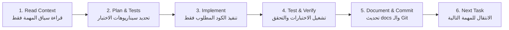

# ProBike — Gym Module: خطة التنفيذ الكاملة (Personal Edition)

> **نسخة شخصية مفصلة على مقاس مستخدم واحد.**  
> هذا التطبيق مبني لشخص واحد فقط — لا App Store، لا مستخدمين آخرين.  
> هذه الوثيقة هي المرجع الرسمي لأي Agent يعمل على المشروع.

---

## 📌 ملخص الفكرة

إضافة **Gym Module** مستقل معماريًا داخل تطبيق **ProBike**.  
الهدف: رفيق تمرين مقاومة شخصي 100% — يعرف تاريخ تمرينك، يذكرك بآخر أداء، وخريطة عضلات 3D تفاعلية تفتح منها تمارين اليوم.

**السياق الشخصي المهم:**
- 📱 **iPhone فقط** — لا Android، لا App Store
- 🎯 **مستخدم واحد** — أنت فقط، لا accounts، لا multi-user
- 🏋️ **بتختار تمارينك يومياً** — مفيش جدول ثابت مفروض عليك (Free Selection)
- ⚖️ **وحدة الوزن: كيلوجرام فقط** — بدون تحويلات
- 🚴 **Heatmap على المجسم 3D** من تمارين الجيم ورحلات الدراجة معاً (Gym + Bike) بدون تنبيهات مزعجة
- 💾 **نسخ احتياطي محلي:** تصدير يدوي لقاعدة البيانات إلى تطبيق Files لحماية تاريخ تمرينك بدون سحابة

> ❌ **خارج النطاق تمامًا:** Heart Rate، Calories، Steps، Health Monitoring، Multi-user، App Store، رخص تجارية، وحدة Pounds

---

## ✅ القرارات المعتمدة (مثبتة شخصياً)

| العنصر | الاختيار المعتمد |
|---|---|
| Framework | Flutter / Dart |
| Platform | **iOS فقط** (iPhone — جهاز شخصي واحد) |
| 3D Style | Realistic Fitness Male Anatomy |
| 3D Engine | **Pending PoC** (RealityKit Native vs Three.js via InAppLocalhostServer) — الاعتماد بالقياس الفعلي على iPhone |
| Interaction | Tap + Touch Scrubbing + Orbit/Explore Modes |
| Anatomy Model | Male (مرخص للاستخدام الشخصي) |
| Training Style | **Free Selection** — بتختار تمارينك يومياً بحرية |
| Workout Logging | وزن + عدات فقط (بدون RPE/RIR) + ثواني للبلانك |
| Set Types | Warmup / Working / Drop |
| Weight Unit | **كيلوجرام فقط** (ثابت في الكود) |
| Weight Input | زرار +2.5 / +5 / +10 kg سريع (بدون Plate Calculator) |
| Architecture | Independent Gym Module |
| Data Strategy | Offline-first (بيانات + صور محلية بالكامل) |
| Data Backup | تصدير يدوي لقاعدة البيانات (SQLite) إلى تطبيق Files / iCloud Drive |
| Media Strategy | صور/GIFs مدمجة في الـ Assets (Zero Loading Time) |
| Installation | **SideStore** (تجديد تلقائي محلي للشهادة بدون كابل) |
| Bike Integration | Muscle Load Heatmap على المجسم 3D من (Gym + Bike) بدون تنبيهات |
| Multi-user | ❌ لا — Single User فقط |
| App Store | ❌ لا — Personal Device فقط |

---

## 📋 المتطلبات الوظيفية (Functional Requirements)

### Core Features — المرحلة الأساسية

| Feature | الوصف |
|---|---|
| Gym Dashboard | شاشة رئيسية: مدخل للـ Muscle Map + آخر الجلسات + تمارين العضلات المفضلة |
| Interactive 3D Muscle Map | مجسم ذكوري تشريحي 3D — كل عضلة قابلة للتحديد بشكل مستقل |
| Muscle Load Heatmap | ألوان على المجسم توضح العضلات المجهدة من الجيم والدراجة |
| Explore Mode | لمس مستمر يُضيء العضلة تحت الإصبع مباشرة |
| Orbit Mode | سحب الإصبع يُدوّر المجسم بدون تحديد عضلات |
| Muscle Page | صفحة كل عضلة: تمارينك المفضلة لها + آخر أداء |
| Exercise Library | مكتبة تمارينك الشخصية — تضيف وتعدل بحرية كاملة |
| **Free Workout Mode** | **تختار تمارين اليوم لحظة بلحظة من غير جدول مسبق** |
| Active Workout Session | وضع تسجيل نشط: Set لـ Set مع Ghost Pre-fill من آخر جلسة |
| Ghost Pre-fill | تعبئة الوزن والعدات تلقائيًا من آخر جلسة بضغطة ✓ واحدة |
| Auto Rest Timer | مؤقت راحة تلقائي بعد تسجيل كل Set |
| Workout History | سجل كامل لكل الجلسات السابقة |
| Progress Analytics | رسوم بيانية لتطور الأوزان + Personal Records |
| Offline Mode | كل وظائف التسجيل تعمل بدون إنترنت — صور مدمجة (Zero Loading) |

### Advanced Features — المرحلة الثانية والثالثة

| Feature | الوصف |
|---|---|
| Set Types | WARMUP / WORKING / DROP + failure_status منفصل |
| Supersets / Trisets | ربط تمارين في مجموعات مركبة |
| Sub-Muscle Quick Chips | وصول سريع للعضلات العميقة المغطاة |
| Exercise Swap (Session Only) | تغيير التمرينة للجلسة الحالية بدون تعديل المكتبة |
| Unilateral Logging | تسجيل اليد/الرجل اليمين واليسار بشكل مستقل |
| iOS Live Activities | عرض مؤقت الراحة على Lock Screen وDynamic Island |
| Bike Integration Bridge | خريطة حمل عضلي تقديرية (Heatmap فقط) من رحلات الدراجة |

> ~~RPE/RIR~~ ← **محذوف** (وزن + عدات بس)  
> ~~Plate Calculator~~ ← **محذوف** (أزرار +2.5/+5/+10 بدلها)  
> ~~Equipment Profiles~~ ← **مبسّط** (إعداد وحيد للبار الشخصي)  
> ~~Lazy Media Caching / CDN~~ ← **محذوف** (صور مدمجة أوفلاين بالكامل)  
> ~~Anatomy Model Versioning~~ ← **محذوف** (تبدل الملف مباشرة وقت ما تحب)  
> ~~lb/kg conversion~~ ← **محذوف** (كيلو فقط hard-coded)  
> ~~License Reference fields~~ ← **محذوف** (استخدام شخصي)

---

## 🏗️ هيكل قاعدة البيانات (Database Schema — Personal Edition)

> **تبسيطات مهمة بسبب Single-User:**
> - ✅ حذف `ANATOMY_MODEL_VERSION` (تبدل الملف مباشرة)
> - ✅ حذف `EQUIPMENT_PROFILE` (البار الشخصي ثابت في Settings)
> - ✅ حذف `license_reference` من EXERCISE_MEDIA
> - ✅ حذف `download_url` و `quality_variant` (كل الميديا محلية)
> - ✅ حذف `rpe` و `rir` من SET_LOG (وزن + عدات بس)
> - ✅ الوزن **كيلوجرام فقط** — بدون حقل unit

```
MUSCLE
  id, name, anatomy_region, muscle_group

MUSCLE_MESH_BINDING
  id, muscle_id, mesh_id, side (L/R/BOTH)
  -- ملاحظة: بدون model_version (موديل واحد فقط)

EXERCISE
  id, name, logging_type, laterality, equipment,
  instructions, asset_key
  -- asset_key: مفتاح الصورة/GIF في Flutter assets (مثل assets/gym/exercises/bench_press.webp)
  -- ملاحظة: تحديد العضلات بالكامل محفوظ في EXERCISE_MUSCLE كمصدر وحيد للحقيقة لمنع التكرار

EXERCISE_MUSCLE
  exercise_id, muscle_id, role (PRIMARY/SECONDARY)

WORKOUT_SESSION
  id, started_at, ended_at, status (IN_PROGRESS/DONE),
  rest_ends_at_utc, rest_duration_seconds, notes
  -- rest_ends_at_utc & rest_duration_seconds: لحفظ واستعادة مؤقت الراحة بدقة حتى بعد إغلاق التطبيق أو Cold Start

SESSION_EXERCISE
  id, session_id, exercise_id,
  performed_exercise_id,  -- لو استبدلت التمرينة في الجلسة دي بس
  superset_group_id, notes, sort_order

SET_LOG
  id, session_exercise_id, set_number, logical_set_id,
  set_type (WARMUP/WORKING/DROP),
  failure_status (NOT_REACHED/TECHNICAL_FAILURE/MUSCULAR_FAILURE),
  weight_kg, reps, duration_seconds, side (BOTH/LEFT/RIGHT),
  rest_taken_seconds, completed

USER_EXERCISE_SETTINGS
  exercise_id, default_rest_seconds, default_bar_weight_kg, notes
  -- default_bar_weight_kg: بديل EQUIPMENT_PROFILE (20 kg للبار، 0 للدمبل)
```

> 💾 **حماية البيانات (Data Safety):**  
> توفير خيار تصدير يدوي `Export Database to Files` لنسخ ملف الـ SQLite إلى Files / iCloud Drive لحماية تاريخ التمرين عند إعادة تثبيت التطبيق أو تحديثه عبر SideStore.

**Exercise Logging Types (المبسطة):**
```dart
enum ExerciseLoggingType {
  weightAndReps,       // الأساسي: دمبل، بار، أجهزة
  bodyweightOnly,      // عقلة، ضغط
  weightedBodyweight,  // عقلة بوزن إضافي
  repsOnly,            // تمارين بالجسم بدون وزن
  durationOnly,        // بلانك، تمارين ثبات
}

enum ExerciseLaterality { bilateral, unilateral, alternating }
```

---

## 🗂️ هيكل مجلدات المشروع

```
lib/
├── core/
│   ├── database/           ← SQLite setup, WAL mode, migrations
│   ├── navigation/
│   ├── theme/
│   └── utilities/
│
├── features/
│   ├── bike/               ← لا يُمس
│   │
│   └── gym/
│       ├── dashboard/
│       ├── muscle_map/
│       │   ├── domain/
│       │   ├── data/
│       │   ├── presentation/
│       │   └── renderer/   ← MuscleMapRenderer interface (قابل للاستبدال)
│       ├── muscles/
│       ├── exercises/
│       ├── workout_session/ ← Free Selection Mode (بدون Programs مسبقة)
│       └── progress/
│
├── shared/
│   ├── audio/              ← AppAudioSessionCoordinator
│   ├── live_activity/      ← LiveActivityManager
│   └── widgets/
│
└── integration/
    └── activity_bridge/    ← Heatmap data (Read-only) من Bike
```

---

## 📐 الصعوبات التقنية الحقيقية (بعد التبسيط الشخصي)

### 🔴 صعوبة عالية — قرارات محورية

| المشكلة | التفصيل | الحل المعتمد |
|---|---|---|
| **محرك 3D على iOS** | لا يوجد حل جاهز مضمون في Flutter للـ 3D التفاعلي الكامل على iPhone | مقارنة مركزة على **iOS فقط**: **RealityKit (Native)** vs **Three.js (InAppLocalhostServer)** |
| **Gesture Arena في 3D** | التدوير والتحديد وإصبع واحد = تعارض حتمي | وضعان منفصلان: **Explore Mode** (تحديد/مسح) و **Orbit Mode** (تدوير) + toggle عائم |
| **Raycasting المستمر** | Raycasting في كل Frame عبر Platform Channel → Lag | الـ Hit Testing يبقى داخل محرك الـ 3D، وFlutter يتلقى أحداث التغيير فقط |
| **حجم وأداء نموذج 3D على iPhone** | موديلات بـ 500K مثلث → سخونة وتقطيع | هدف: 35–50K مثلث + Draco Compression واختبار على iPhone الفعلي |

### 🟡 صعوبة متوسطة — تحتاج تصميم دقيق

| المشكلة | التفصيل | الحل المعتمد |
|---|---|---|
| **تعارض Bike + Gym على SQLite** | كاتب GPS للدراجة + تسجيل Sets للجيم في نفس الوقت | تفعيل WAL Mode + طابور كتابة متسلسل واحد (Serialized Write Queue) مع Busy Timeout وإعادة محاولة؛ لأن SQLite يسمح بكاتب واحد في اللحظة حتى مع WAL |
| **انقطاع الموسيقى في الجيم** | مشغل الوسائط يسحب Audio Focus من Spotify | `mixWithOthers: true` في إعدادات الصوت المركزية — لا شيء يوقف موسيقاك |
| **العضلات العميقة المغطاة** | عضلات مثل Rhomboids تحت Trapezius | Sub-Muscle Quick Chips سريعة أسفل الشاشة للوصول بلمسة واحدة |
| **تعارض Live Activities** | رحلة الدراجة + مؤقت راحة الجيم على Dynamic Island | سياسة موحدة: Bike أثناء تسجيل رحلة نشطة، وGym Rest Timer عند إيقاف الرحلة مؤقتاً، مع إشعار صوتي عند انتهاء الراحة |
| **استقرار SQLite وإصداراته** | مشكلات قديمة في إصدارات معينة من SQLite مع WAL | فحص إصدار المحرك الفعلي في Phase 0 واعتماد معالجة SQLITE_BUSY الصارمة |

> 💡 **أفخاخ تم إلغاؤها لأن التطبيق لك وحدك:**  
> - ❌ لا CDN ولا Lazy Downloading معقد: التمارين بصور/GIFs خفيفة ومدمجة في assets وتفتح فوري (Zero Lag).  
> - ❌ لا دعم لأجهزة Android أو محرك Filament (توفير 50% من مجهود الـ 3D للتركيز على iPhone).

### 🟢 صعوبة منخفضة — تنفيذ مباشر

| المشكلة | الحل |
|---|---|
| **Unilateral Logging** | `logical_set_id` + `side` (Left/Right) في SET_LOG لتسجيل كل طرف بدقة |
| **الوزن وسرعة الإدخال** | أزرار سريعة (+2.5 / +5 / +10 kg) وزر تأكيد ✓ للـ Ghost Pre-fill بلمسة واحدة |
| **تغيير التمرينة لحظيًا** | تبديل سريع في الجلسة الحالية لو الجهاز مشغول في الجيم |
| **استعادة الجلسة عند إغلاق التطبيق** | كتابة فورية لكل Set في SQLite — فتح فوري للجلسة النشطة حتى بعد إغلاق التطبيق |

---

## 🤖 ما يقدر يعمله الـ Agent (مفصل لك)

### ✅ Agent يعمله بشكل مستقل تام

- [ ] **Technical Audit (Phase 0)** — فحص مشروع ProBike الحالي وقراءة التوثيق (READ ONLY)
- [ ] **Database Schema (Personal)** — إنشاء الجداول المبسطة بدون حقول التراخيص أو تعدد العملات/الوحدات
- [ ] **Gym Module Architecture** — تنظيم كود الـ Gym كـ feature مستقلة داخل `lib/features/gym/`
- [ ] **Exercise Seed Data** — إضافة تمارينك المفضلة كبيانات أولية مع صور/GIFs مدمجة
- [ ] **Free Workout Mode** — بناء شاشة اختيار التمارين اليومية الحرة بدون إجبار على جدول
- [ ] **Active Workout Screen** — شاشة التسجيل النظيفة (وزن بالكيلو + عدات + نوع المجموعة + زر ✓ سريع)
- [ ] **Quick Weight Buttons** — أزرار الزيادة السريعة (+2.5 / +5 / +10 kg)
- [ ] **Ghost Pre-fill Logic** — اقتراح أرقام آخر جلسة تلقائيًا في كل مجموعة
- [ ] **Auto Rest Timer** — مؤقت راحة تلقائي مع تنبيه خفيف بدون قطع الموسيقى
- [ ] **Progress Charts** — رسوم بيانية نظيفة لتطور أوزانك والأرقام القياسية (PRs)
- [ ] **Sub-Muscle Quick Chips** — شريط العضلات العميقة أسفل شاشة الـ 3D
- [ ] **Activity Integration Bridge** — قراءة بيانات رحلات العجلة لحساب وتلوين العضلات المجهدة (Heatmap فقط)
- [ ] **Crash-Safe Persistence** — حفظ لحظي لكل Set لضمان عدم ضياع أي تمرين لو فتحت الكاميرا
- [ ] **iOS Live Activities** — إظهار مؤقت الراحة على Dynamic Island وشاشة القفل
- [ ] **3D Prototype على iOS** — اختبار النموذج التفاعلي (RealityKit vs Three.js)

---

## 👤 ما يحتاج تدخلك أنت فقط (Human Decisions)

> قراراتك أصبحت سهلة ومباشرة بعد إلغاء التعقيدات التجارية:

1. **ملف مجسم الـ 3D:** اختيار أو تنزيل ملف GLB لجسم رياضي ذكوري مقسم العضلات (مع التأكد من ملاءمة شروط ترخيصه للاستخدام الشخصي/الداخلي).
2. **قائمة تمارينك المفضلة:** ترسل للـ Agent أسماء التمارين التي تلعبها عادة حتى يضعها كبيانات افتراضية جاهزة مع مفاتيح الـ assets.
3. **اعتماد محرك الـ 3D:** بعد أن يُنهي الـ Agent الـ PoC ويقارن RealityKit بـ Three.js على جهازك، تختار الأنسب سلاسة وشكلاً.
4. **تثبيت التطبيق وتشغيله:** التطبيق مخصص لجهازك الشخصي ويتم تثبيته عبر SideStore، حيث يقوم SideStore بتجديد صلاحية الشهادة دورياً وتلقائياً عبر الشبكة المحلية لتفادي انتهاء الـ 7 أيام بدون كابل، مع بقاء حدود شهادات المطور المجانية سارية على النظام.
5. **النسخ الاحتياطي اليدوي:** استخدام زر تصدير الداتابيز إلى تطبيق Files لحفظ سجل تمارينك في أي وقت.

---

## 🔄 نظام حوكمة وعمل الـ AI Agent (Workflow & Quality Gate)

الهدف هو فرض انضباط صارم على الـ Agent لمنع التشتت أو إعلان اكتمال مهام ناقصة. يعمل الـ Agent عبر حلقة صارمة من 6 خطوات:



### دورة عمل الـ Agent (6-Step Loop):
1. **Read Context:** يقرأ تعليمات المشروع، الحالة الحالية، والمهمة المطلوبة فقط بدون قراءة كل الملفات لتوفير التوكنز.
2. **Plan & Define Tests:** يحدد الملفات التي سيعدلها ومعايير القبول (Acceptance Criteria) وسيناريوهات الاختبار قبل كتابة الكود.
3. **Implement:** ينفذ الكود اللازم للمهمة فقط بدون أي Refactoring غير مطلوب للكود القديم.
4. **Test & Verify:** يشغل الاختبارات المحددة ويتأكد من نجاحها بالكامل على الجهاز.
5. **Document & Commit:** يُحدّث سجل المهام و`CHANGELOG.md` ويسجل ما تم فعلياً ونتائج الفحص، ثم يقوم بعمل Commit صغير.
6. **Next Task:** ينتقل للمهمة التالية فقط بعد اجتياز بوابة الاختبار بنجاح، أو يسجل سبب التوقف في `STATUS.md`.

### الحالات الست للمهام (Task States):

| الحالة | المعنى والشرط |
|---|---|
| `TODO` | لم تبدأ بعد. |
| `IN_PROGRESS` | قيد العمل والتنفيذ حالياً. |
| `PARTIAL` | نُفّذ جزء منها ولم تكتمل باقي المتطلبات أو الاختبارات (يُمنع اعتبارها منتهية). |
| `BLOCKED` | متوقفة بسبب مانع تقني أو قرار بشري مطلوب. |
| `DONE` | اكتملت بنسبة 100% واجتازت جميع الاختبارات المحددة ووثقت بالكامل. |
| `SKIPPED` | تم إلغاؤها بقرار مع توثيق السبب بوضوح. |

> ⛔ **قاعدة بوابة الجودة الصارمة (Quality Gate):**  
> يُمنع منعاً باتاً نقل أي مهمة إلى `DONE` بمجرد كتابة الكود؛ لا تصبح المهمة `DONE` إلا بعد تشغيل اختباراتها بنجاح وتحديث ملفات التوثيق.

---

## 📑 هيكل ملفات التوثيق التشغيلية (`docs/gym/`)

تُحفظ ملفات التتبع والتشغيل داخل مجلد `docs/gym/` لضمان عزل عالم الجيم تماماً عن كود ووثائق الدراجة:

```
docs/gym/
├── STATUS.md        ← الوضع اللحظي الحالي للمشروع والمهمة التالية مباشرة
├── TASKS.md         ← قائمة جميع المهام بتفاصيلها وحالتها (TODO / IN_PROGRESS / DONE / ...)
├── CODEMAP.md       ← خريطة سريعة للملفات والمسؤوليات لمنع التشتت
├── TEST_PLAN.md     ← سيناريوهات الاختبار، معايير القبول، والنتائج المسجلة
├── CHANGELOG.md     ← سجل التغييرات والتحسينات الفعلية التي نُفذت
└── AGENT_LOG.md     ← سجل قرارات الـ Agent المعمارية وملاحظات التنفيذ
```

---

## 🧪 نظام ومصفوفة الاختبارات (Testing System)

نفرق بوضوح بين:
- **معايير القبول (Acceptance Criteria):** ما المطلوب أن يحققه الكود بالضبط؟
- **سيناريوهات الاختبار (Test Scenarios):** كيف نتحقق عملياً من تحقق المطلوب؟

### المستويات الأربعة للاختبار:
1. **Unit Tests:** اختبار المنطق المجرد (مثل منطق Ghost Pre-fill وحساب الأوزان السريعة).
2. **Widget Tests:** التأكد من عمل الواجهات والأزرار والانتقالات بسلاسة.
3. **Integration Tests:** اختبار المسار الكامل (من اختيار العضلة حتى تسجيل الـ Set وتخزينها).
4. **iPhone Manual Tests:** اختبار الـ 3D والبطارية، وعدم قطع Spotify، واستقرار Dynamic Island.

### مصفوفة الاختبارات الأساسية (Initial Test Matrix):

| المجال | سيناريوهات الفحص الأساسية |
|---|---|
| **Workout Logic** | استرجاع آخر أداء بدقة، استثناء التسخين من قيم الاقتراح، أزرار الزيادة السريعة (+2.5/+5/+10)، تسجيل الطرفين (Left/Right) عند التباين، استبدال تمرينة اليوم دون التأثير على البرنامج. |
| **Database & Recovery** | حفظ الـ Set فور تأكيدها، استعادة الجلسة ومؤقت الراحة (`rest_ends_at_utc`) بعد قتل التطبيق أو Cold Start، الصمود أمام `SQLITE_BUSY` بإعادة المحاولة بدون فقد بيانات. |
| **3D Muscle Map** | دقة اختيار العضلة بـ Tap أو Scrubbing، انعدام التعارض بين Orbit Mode وExplore Mode، وصول سريع للعضلات العميقة عبر Quick Chips، ثبات معدل الإطارات (FPS) والحرارة على iPhone. |
| **Bike Regression** | استمرار تسجيل GPS ورحلات العجلة بسلاسة أثناء تسجيل جلسات الجيم بدون أي تداخل أو قفل للداتابيز. |
| **iOS Experience** | عدم انقطاع Spotify عند فتح فيديوهات/صور التمارين (`mixWithOthers`)، عمل مؤقت الراحة في الخلفية، استعادة التطبيق بعد فتح الكاميرا، العمل في وضع الطيران أوفلاين 100%. |

---

## 🌿 استراتيجية Git وضبط استهلاك الـ Tokens

بما أن التطبيق مخصص لك وحدك، لا داعي لتعقيدات الـ CI/CD وفروع لكل مهمة:

- **فرع عمل موحد:** العمل محلياً على فرع واحد مخصص: `feature/gym-personal`.
- **Commits صغيرة وموثقة:** بعد نجاح اختبارات كل مهمة وتحديث `docs/gym/CHANGELOG.md`، يتم عمل Commit نظيف وواضح.
- **توفير التوكنز والوقت:**
  - الـ Agent يقرأ فقط الملفات المرتبطة بالمهمة الحالية (`docs/gym/STATUS.md`, `docs/gym/TASKS.md`, الكود المعني).
  - حظر إعادة كتابة (Refactor) كود يعمل بالفعل لمجرد تحسين التنسيق.
  - حظر إضافة حزم ومكتبات خارجية لأي ميزة بسيطة يمكن برمجتها محلياً.
  - حظر تعديل أي كود في Bike Tracking خارج نطاق الـ Integration Bridge.

---

## 🗺️ مراحل التنفيذ (5 Phases)

```
Phase 0 → Phase 1 → Phase 2 → Phase 3 → Phase 4
Technical   3D PoC   Gym        Workout   Intelligence
Audit       🔬        Foundation Engine    & Polish
📖 READ     PROTOTYPE 🏗️ BUILD  💪 CORE  📊 ADVANCE
ONLY
```

---

### Phase 0 — Technical Audit `(READ ONLY)`

**الهدف:** فهم المشروع الحالي قبل لمس أي كود.

**ما يراجعه الـ Agent:**
- Flutter + Dart versions
- iOS deployment target + Android min SDK
- Architecture + State Management
- Database + Navigation
- Dependencies + Asset management
- Bike Tracking data models والـ invariants
- AGENT_CONTEXT.md والتوثيق الحالي

**الناتج (Deliverables):**
- `TECHNICAL_AUDIT.md`
- `EXISTING_ARCHITECTURE.md`
- `DEPENDENCY_COMPATIBILITY.md`
- `BIKE_TRACKING_INVARIANTS.md`
- `GYM_MODULE_INTEGRATION_PLAN.md`

> ⚠️ **لا تعديل في production files خلال هذه المرحلة**

---

### Phase 1 — 3D Proof of Concept

**الهدف:** إثبات نجاح محرك الـ 3D على iPhone الحقيقي.

**ما يُبنى:**
- نموذج GLB مقسم (10+ عضلات منفصلة)
- Explore Mode + Orbit Mode
- Tap Selection + Touch Scrubbing
- Smooth Camera Focus
- Highlight وانتقال بين العضلات

**ما يُقاس:**
- FPS أثناء التدوير
- زمن تحميل النموذج
- دقة تحديد العضلات
- استهلاك الذاكرة والبطارية
- حرارة الجهاز

**الناتج:** `3D_POC_REPORT.md` + قرار المحرك المعتمد

> ⚠️ **انتظار موافقة على النتائج قبل Phase 2**

---

### Phase 2 — Gym Foundation

**ما يُبنى:**
- Gym Dashboard (مع خريطة العضلات المجهدة Heatmap)
- Muscle Map ثلاثية الأبعاد (بالمحرك المعتمد على iOS)
- Exercise Library + Local Database (بيانات تمارينك وصورها محلياً)
- Free Workout Selection (اختيار تمارين اليوم بحرية تامة)
- Local Database مع WAL Mode ونظام كتابة آمن

**الناتج:** Gym Module MVP جاهز للاستخدام اليومي

---

### Phase 3 — Workout Engine

**ما يُبنى:**
- Active Workout Mode (سريع وبسيط: كرت التمرينة + الوزن بالكيلو + العدات)
- Ghost Pre-fill (تعبئة أرقام آخر جلسة تلقائياً + تأكيد بلمسة واحدة)
- أزرار الزيادة السريعة للأوزان (+2.5 / +5 / +10 kg)
- Set Types (Warmup / Working / Drop)
- Auto Rest Timer + iOS Live Activities على Dynamic Island
- Exercise Swap (تبديل التمرينة للجلسة الحالية لو الجهاز مشغول)
- Unilateral Logging (تسجيل الطرفين لو العدات مختلفة)
- Crash-Safe Session Persistence (حفظ لحظي يضمن عدم ضياع أي تكرار)

**الناتج:** نظام تسجيل تمرين متكامل وشديد السرعة في الجيم

---

### Phase 4 — Intelligence & Polish

**ما يُبنى:**
- Progress Analytics + Personal Records (رسوم بيانية لتطور الأوزان)
- Muscle Load Heatmap (تلوين عضلات المجسم 3D بالأحمر والأصفر والأخضر بناءً على تمارين الجيم وجولات العجلة)
- Activity Integration Bridge (قراءة ملخصات رحلات ProBike بدون أي تنبيهات مزعجة)
- Sub-Muscle Quick Chips (للوصول للعضلات المغطاة بلمسة واحدة)
- Performance Optimization واختبار الاستهلاك والبطارية على iPhone
- فحص واختبار الـ Edge Cases الخاصة بجهازك

**الناتج:** ProBike Gym — النسخة الشخصية النهائية المستقرة

---

## ✅ Definition of Done — سيناريو القبول الكامل

يُعتبر Gym Module مكتملًا تماماً عندما يمكنك:

1. فتح Gym Dashboard ورؤية العضلات المجهدة ملونة على المجسم 3D
2. تدوير المجسم وتكبيره بسلاسة على شاشة الـ iPhone
3. الضغط على أي عضلة أو مسحها بالإصبع فتضيء فوراً
4. فتح تمارين العضلة واختيار ما ستلعبه اليوم بحرية
5. مشاهدة صورة/GIF التكنيك وآخر وزن وعدد سجلته فيها
6. بدء التمرين بضغطة واحدة، وتأكيد أوزان اليوم بضغطة ✓ عبر Ghost Pre-fill أو زيادة سريعة (+2.5/+5 kg)
7. بدء مؤقت الراحة تلقائياً وظهوره في الـ Dynamic Island وشاشة القفل
8. سماع نغمة انتهاء الراحة مع استمرار تشغيل الموسيقى على Spotify بسلاسة
9. إنهاء الجلسة وحفظها محلياً فوراً
10. العودة للتمرين في أي وقت لتجد كل أرقامك مسجلة ورسومك البيانية محدثة
11. عمل كل ذلك بدون إنترنت تماماً وبدون أي تأثير على تسجيل مسارات العجلة

---

## 🧪 Edge Cases الإلزامية (محددة لجهازك)

| # | السيناريو |
|---|---|
| 1 | Bike GPS يكتب بيانات بينما الجيم يسجل Set في نفس اللحظة |
| 2 | إغلاق التطبيق فجأة أو فتحه بعد فترة أثناء مؤقت الراحة |
| 3 | فتح كاميرا الآيفون لتصوير مجموعة تمرين ثم العودة للتطبيق |
| 4 | تغيير وقت الآيفون أو السفر وتغير المنطقة الزمنية |
| 5 | تشغيل الموسيقى عبر Spotify/سماعات البلوتوث أثناء فتح صور وتمارين الجيم |
| 6 | رنين مؤقت الراحة وموسيقى الآيفون تعمل (Ducking خفيف ثم عودة الصوت) |
| 7 | رفض إذن Live Activities أو قفل Dynamic Island |
| 8 | تسجيل رحلة دراجة ومؤقت راحة الجيم نشط في نفس الوقت |
| 9 | تحديد عضلات الظهر العميقة (الرومبويد) عبر الـ Quick Chips |
| 10 | تكرارات مختلفة بين الذراع الأيمن والأيسر في تمرين دمبل فردي |
| 11 | تبديل تمرينة اليوم فقط دون التأثير على السجل التاريخي |
| 12 | صمود واستقرار الـ SQLite في وضع WAL بدون أي Database Lock |
| 13 | فتح التطبيق وعرض المجسم 3D والتمارين في وضع الطيران (بدون إنترنت تماماً) |

---

## 📄 الوثائق المطلوبة

### 1. ملفات الحوكمة والتشغيل اليومي (`docs/`)
| الملف | وظيفته ومحتواه |
|---|---|
| `docs/TASKS.md` | قائمة كافة المهام وحالة كل مهمة بدقة (`TODO`, `IN_PROGRESS`, `DONE`, إلخ) |
| `docs/STATUS.md` | الوضع اللحظي الحالي للمشروع والمهمة التالية مباشرة |
| `docs/CHANGELOG.md` | سجل زمني بالتغييرات والتحسينات الفعلية التي تمت بنجاح |
| `docs/AGENT_LOG.md` | سجل مختصر لعمل الـ Agent والقرارات المعمارية التي اتخذها |
| `docs/TEST_PLAN.md` | سيناريوهات الاختبار، معايير القبول، ونتائج الفحص المسجلة |
| `docs/CODEMAP.md` | خريطة الملفات والمسؤوليات لتوجيه الـ Agent ومنع التشتت |

### 2. الوثائق المعمارية والتقنية
| الملف | المحتوى |
|---|---|
| `GYM_MODULE_PRD.md` | وثيقة المتطلبات للنسخة الشخصية |
| `GYM_TECHNICAL_DESIGN.md` | المعمارية الخاصة بـ iOS وتكامل الـ 3D |
| `GYM_DATABASE_SCHEMA.md` | المخطط النهائي للجداول المبسطة |
| `GYM_3D_RENDERER_DECISION.md` | نتائج الـ PoC على الآيفون والقرار المعتمد |
| `GYM_IMPLEMENTATION_PLAN.md` | خطة التنفيذ خطوة بخطوة |
| `TECHNICAL_AUDIT.md` | تقرير فحص كود ProBike الحالي (Phase 0) |
| `3D_POC_REPORT.md` | تقرير اختبار الـ 3D على جهازك الفعلي (Phase 1) |
| `BIKE_TRACKING_INVARIANTS.md` | قواعد حماية كود العجلة الحالي من أي كسر |

---

## 🏛️ المعمارية الكبيرة (Personal Architecture)

```
ProBike App (iPhone)
├── Bike Module (لا يُمس إطلاقاً)
│
├── Gym Module (مستقل 100%)
│   ├── 3D Anatomy Engine  ←── MuscleMapRenderer Interface
│   │   ├── Candidate A: Three.js + WebView (InAppLocalhostServer)
│   │   └── Candidate B: RealityKit (Native iOS)
│   │
│   ├── Gym Training Engine
│   │   ├── Free Exercise Selection & Sets Logging (kg only)
│   │   ├── Ghost Pre-fill & Quick Weight (+2.5, +5, +10)
│   │   └── Auto Rest Timer & Session History
│   │
│   └── Activity Integration Bridge (Read-only: Bike Rides → 3D Muscle Heatmap)
│
└── Shared Infrastructure
    ├── SQLite + WAL Mode (Single Write Queue)
    ├── AppAudioSessionCoordinator (Spotify-friendly audio mix)
    └── LiveActivityManager (Dynamic Island Rest Timer)
```

---

## 🎯 نظام التفاعل مع الـ 3D

| الحالة | السلوك |
|---|---|
| **Idle** | المجسم في وضعه الطبيعي، إضاءة هادئة |
| **Hover / Scrubbing** | العضلة تحت الإصبع تُضاء تدريجيًا |
| **Selected** | العضلة مثبتة + tooltip باسمها |
| **Multi-highlight** | العضلات الأساسية والثانوية مضاءة بألوان مختلفة |
| **Rotating (Orbit Mode)** | الجسم يدور بدون أي تحديد عضلات |
| **Zooming** | Pinch بإصبعين في كلا الوضعين |

**قاعدة ذهبية:** كل الـ Raycasting والـ Hit Testing يبقى داخل محرك الـ 3D.
Flutter يتلقى فقط:
```
onMuscleHoveredChanged(meshId)
onMuscleSelected(muscleId)
onCameraInteractionChanged(isInteracting)
```

---

## 🔊 إدارة الصوت المركزية

```dart
enum AppAudioMode {
  passiveVideo,       // mixWithOthers: true — لا يقطع الموسيقى
  restAlert,          // Ducking مؤقت في Foreground فقط
  backgroundNavigation,
  inactive,
}
```

> ⚠️ لا يُسمح لأي Feature بتغيير AVAudioSession مباشرة. كل شيء عبر `AppAudioSessionCoordinator`.

---

## 📊 Live Activities Priority Policy

| الحالة | الأولوية |
|---|---|
| Bike Ride نشطة | Bike |
| Bike Paused + Gym نشط | Gym |
| Bike نشطة + Gym Rest | Bike + تنبيه الراحة |
| Gym فقط | Gym |
| Live Activities غير متاحة | Notifications + In-App Timer |

---

## ⚡ الـ Master Prompt الهندسي الجاهز للـ Agent (Personal Edition)

> انسخ هذا الـ Prompt وأرسله للـ Agent مع ملفات المشروع للبدء فوراً:

```
# ProBike — Gym Module Engineering Mission (Personal Edition)

## Role & Context
Act as a Senior iOS & Flutter Architect, Mobile Graphics Engineer,
and High-Performance Software Engineer.

You are working on an existing Flutter application called ProBike.
This application is strictly for a SINGLE PERSONAL USER (not distributed
on the App Store, no multi-user, no commercial licensing concerns).
Target Platform: iOS ONLY (iPhone). Do not implement or test Android/Filament.

Your mission is to audit the existing project and build an isolated,
high-performance Gym Module tailored to the owner's exact workout habits,
without breaking, rewriting, or modifying the existing Bike Tracking functionality.

## 1. Mandatory Personal Guidelines & Constraints

- Target Platform: iOS ONLY (iPhone). No Android code or dependencies.
- Single User: No accounts, no multi-user abstractions, no commercial licensing checks.
- Weight Unit: Kilograms (kg) strictly. Do not implement lb or unit conversion code.
- Workout Style: Free Exercise Selection Mode (user picks exercises on the fly;
  do not enforce rigid predefined workout programs or calendar days).
- Logging Style: Clean & Fast (Weight kg + Reps + Set Type: Warmup/Working/Drop).
  Do NOT implement RPE/RIR or Plate Calculator.
- Quick Weights: Provide quick weight increment buttons (+2.5, +5, +10 kg).
- Media Strategy: All illustrations/GIFs are bundled locally in assets (Zero network latency).
  Do NOT build a CDN or complex lazy-video download manager.
- Bike Integration: Read-only summary bridge to render a Muscle Load Heatmap
  (Red/Yellow/Green) on the 3D anatomical body derived from both Gym sessions and Bike rides. Do NOT show intrusive workout warnings.
- Git Workflow: Work strictly on a single dedicated personal branch 'feature/gym-personal' with small, disciplined commits per verified task.
- Governance & Documentation: Maintain and update docs/gym/TASKS.md, docs/gym/STATUS.md, docs/gym/CHANGELOG.md, docs/gym/AGENT_LOG.md, docs/gym/TEST_PLAN.md, and docs/gym/CODEMAP.md across all tasks.
- Quality Gate: Never mark a task DONE without running and passing its designated tests and updating the documentation.
- Efficiency & Tokens: Do not refactor existing working code, do not reformat files needlessly, do not add external packages unless strictly necessary, and read only task-relevant files.
- Data Backup: Implement a simple manual 'Export Database to Files' action for personal backups.
- Preserve all existing Bike Tracking features and architecture.

## 2. Phase 0 — Technical Audit (READ ONLY)

Inspect:
- Flutter and Dart versions.
- iOS deployment target and build configuration.
- Architecture, navigation, and state management.
- Existing database setup and dependencies.
- Asset pipeline and audio configuration.
- Bike Tracking invariants and data storage.

Do not alter production files during this phase.

Produce:
1. TECHNICAL_AUDIT.md
2. EXISTING_ARCHITECTURE.md
3. DEPENDENCY_COMPATIBILITY.md
4. BIKE_TRACKING_INVARIANTS.md
5. GYM_MODULE_INTEGRATION_PLAN.md

## 3. Phase 1 — 3D Rendering Proof of Concept (iOS Focused)

Evaluate two alternatives for iPhone:
A. RealityKit via Native PlatformView / MethodChannel (Apple's recommended native 3D).
B. Three.js inside flutter_inappwebview using InAppLocalhostServer.

Required 3D Capabilities:
- Realistic male fitness anatomy model (.glb).
- Independent muscle meshes with clean naming.
- Front/Back views, 360-degree rotation, pinch-to-zoom.
- Two distinct modes: Explore Mode (touch scrubbing & highlight) vs Orbit Mode (rotation).
- Linked left/right regions (e.g. tapping left pec highlights right pec too).
- Camera focus and smooth selection transitions.
- Heatmap rendering support (tinting fatigued muscles based on recent training).

Hit-testing must remain inside the 3D engine; notify Flutter only when selection changes.

Produce: 3D_POC_REPORT.md with measured FPS, memory, and recommended renderer.

## 4. Phase 2 — Gym Foundation & Database

Implement independent Gym feature under lib/features/gym/ with clean interfaces:

Database Schema (SQLite with WAL mode):
- MUSCLE: id, name, anatomy_region, muscle_group
- MUSCLE_MESH_BINDING: id, muscle_id, mesh_id, side (L/R/BOTH)
- EXERCISE: id, name, logging_type, laterality, equipment, instructions, asset_key
- EXERCISE_MUSCLE: exercise_id, muscle_id, role (PRIMARY/SECONDARY)
- WORKOUT_SESSION: id, started_at, ended_at, status (IN_PROGRESS/DONE), rest_ends_at_utc, rest_duration_seconds, notes
- SESSION_EXERCISE: id, session_id, exercise_id, performed_exercise_id, superset_group_id, notes, sort_order
- SET_LOG: id, session_exercise_id, set_number, logical_set_id, set_type (WARMUP/WORKING/DROP), failure_status, weight_kg, reps, duration_seconds, side (BOTH/LEFT/RIGHT), rest_taken_seconds, completed
- USER_EXERCISE_SETTINGS: exercise_id, default_rest_seconds, default_bar_weight_kg, notes

## 5. Phase 3 — High-Speed Workout Engine

- Active Workout Screen: Minimalist, clean UI with zero clutter.
- Ghost Pre-fill: Pre-populate weight and reps from previous completed session in faint text; confirm with a single tap (✓).
- Quick Increment Buttons: +2.5 kg, +5 kg, +10 kg.
- Auto Rest Timer: Starts automatically when a set is marked complete.
- iOS Live Activities: Display rest countdown on Dynamic Island & Lock Screen via ActivityKit.
- Audio Session Harmony: Exercise previews must use mixWithOthers: true (never stop Spotify). Rest alerts must use temporary audio ducking.
- On-the-Fly Exercise Replacement: Swap an occupied machine for this session only.
- Unilateral Logging: Support independent records for left and right limbs when reps differ.
- Crash-Safe Persistence: Write every set immediately to SQLite; restore active session seamlessly on cold start.

## 6. Phase 4 — Analytics & Heatmap Polish

- Progress Charts: Weight progression graphs & Personal Records (PRs).
- Activity Integration Bridge: Read recent Bike ride distances & durations; calculate recent leg load and render the 3D Muscle Heatmap.
- Sub-Muscle Quick Chips: Instant accessibility chips for deep/occluded muscles (e.g. Rhomboids).
- Performance & Battery Optimization on iPhone.

## 7. Mandatory Operational Safeguards

1. Concurrency: Enforce PRAGMA journal_mode=WAL; and a serialized write queue with busy_timeout and bounded retries to prevent locks between Bike GPS and Gym sets.
2. Audio: Centralize AVAudioSession in AppAudioSessionCoordinator. Muted assets must never interrupt Spotify.
3. Monotonic Time: Calculate rest countdowns using monotonic device time; persist target UTC timestamps for background recovery.
4. Local Serving: If Three.js is chosen, serve assets via InAppLocalhostServer (never file://).

Do not begin full production code until the Phase 0 audit and Phase 1 3D PoC are reviewed.
```

---

## 🚦 الخطوة التالية الآن

1. **لأول جلسة فقط (Phase 0):** أرسل الـ Master Prompt أعلاه للـ Agent لبدء **Technical Audit** وقراءة كود ProBike دون تغيير أي ملفات.
2. **لكل الجلسات والمهام القادمة (توفير 90% من التوكنز والوقت):**  
   لا ترسل هذا الملف الكبير مجدداً! استخدم البرومبت الرشيق التالي:
   > *"اقرأ `docs/gym/STATUS.md` لمعرفة وضع المشروع الحالي، ونفّذ المهمة القادمة المحددة فيه من `docs/gym/TASKS.md`، وافحصها وفق معايير `docs/gym/TEST_PLAN.md`، ثم وثّق ما قمت به في `docs/gym/CHANGELOG.md` واعمل Commit."*
3. **تجهيز مجسم 3D (.glb):** اختيار ملف GLB لجسم رياضي ذكوري مقسم العضلات.
4. **تزويد الـ Agent بتمارينك المفضلة:** ليضعها كبيانات افتراضية مدمجة في Phase 2.

---

*آخر تحديث: نوفمبر 2026 — النسخة الشخصية المعتمدة (Personal Edition)*

